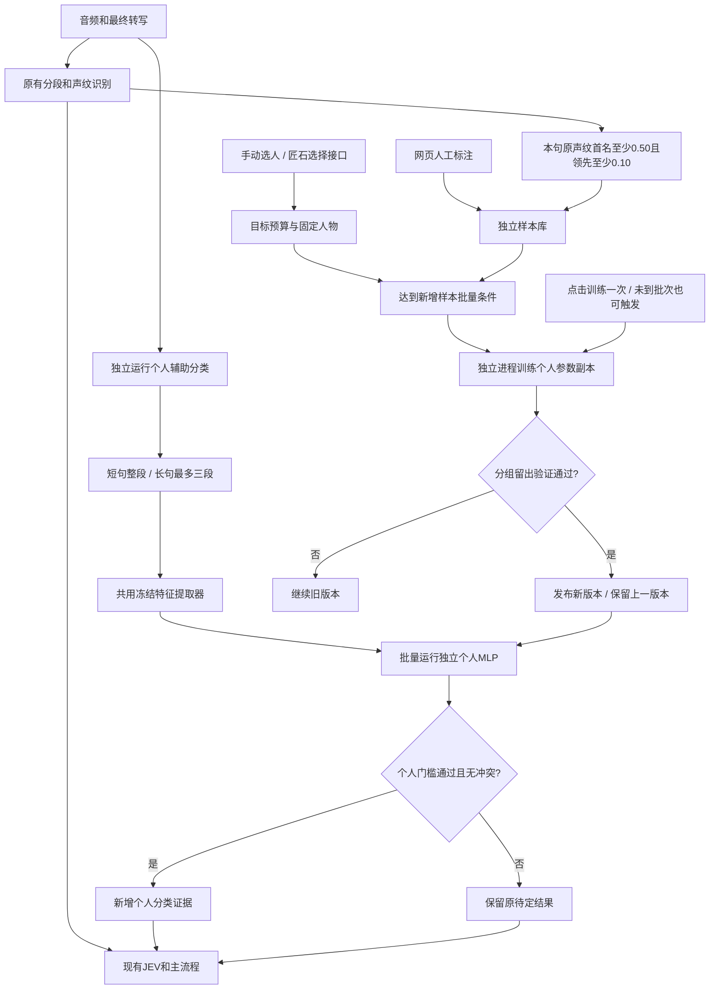

# 个人声音辅助分类

## 扩充后的实际数据与发布核对（2026-10-19）

第二批已实际导入来自44条不同节目录音的514个有效片段。两批公开电视／新闻／辩论语料共87条原录音、1027个片段；本地明确标注的电视／设备反例现有44条。样本库合计2942条片段（2727条公开背景片段、215条本地样本）；片段数不冒称独立说话人数或独立录音数。每个人训练时仍只使用该目标可用的正例及明确反例，复用累计数据，按原录音/来源分组。本地电视权重保持优先，不因公开数量增加被淹没。

扩大数据后已再次训练并发布lux、qf、luguang，分别有91、56、24条本人正例。已逐一核对三个当前版本均可用、均保留上一版参数文件；模型仍为试用版，不声称独立验证已充分。第二批导入及校验摘要见work/tv-negative-expansion-report.json；模型与备份核对见work/live-training-expanded-models-report.json。

程序相关完整回归390项通过，另完成界面检查。后台训练持续出分的修复需重启语音服务加载，分离模型仍按用户选择保持关闭。

## 训练期间持续出分与备份（2026-10-18）

后台训练从当前已发布参数读取并复制到独立训练进程，不原地修改线上参数。标签纠正、删除或撤销后，旧模型仍输出全部参考分数，标注“旧版参考”；不再因全局标签版本变化把全部模型滤掉。只有其直接身份确认与强证据资格暂停，正式人工归属不受影响。管理页显示“旧版参考可用”。无已发布模型、声纹特征空间不同、用户暂停或移除目标另行处理，不伪造可用参数。

新模型以最新数据快照训练，训练期间再改标签的旧候选不得发布，并自动重新安排最新标签的训练。兼容的旧参数可继续作为训练起点；旧验证结果不冒称适用于改过的标签。成功后原子切换当前指针，始终保存前一版，包括标签版本不同的旧版；回退旧标签版本时仍只输出参考分数。训练失败或验证不通过不清空当前已发布模型。

## MLP显示与0.92门槛（2026-10-18 23:10，北京时间）

姓名候选及个人分类器直接确认统一要求分数至少0.92，模型自身校准门槛更高则取更高值；所有分数仍显示，不丢弃低分结果。仍比较全部模型，要求唯一过门槛且领先至少0.10。有效模型的参考分数、正式确认与训练标签是不同用途。

混合录音中若只有一个模型强领先，也在句首显示例如lux[MLP可能1.00]；保留“重叠参考”，不认为整段混合声音只属于一个人、不允许收录单个人训练样本。该界面候选不提升传给JEV的混合录音mlp_high/mlp_priority标志，不覆盖人工或已确认归属。电视反例可能也有极高分，提高门槛不能替代本地明确标注、反例训练与独立验证。

已核对新增批次统计包含本地“其他”等明确反例，不只统计正例；新增到既有10条批次会检查各目标训练，也可人工“训练一次”立即使用累计数据。本地电视/设备样本仍占设备类75%训练权重，公开样本25%。

## MLP独立运行与后台补回（2026-10-18）

每条有有效音频的输入都运行全部兼容的已启用个人模型，不以声纹分数、是否有候选、是否已经确认人物或人工标签作为执行开关。MLP直接从本句PCM提取自身所需的冻结特征，再对所有个人模型出分；共享特征空间不等于依赖声纹匹配结果。人工归属及可靠原声纹身份仍保留，不被单个MLP自动覆盖。

播报/思考期间的控制入口立即调用原JEV，MLP并行后台计算，不增加打断等待。输入多时逐条排队，不因上一条忙碌直接跳过；正常入口达到等待上限后任务仍继续，结果按原input_id更新MLP分数、分歧提示、详情及录音诊断。没有完成的分数不会冒称已参与当前JEV判断；晚回分数不自动改写已生效的JEV归属，不额外补调一次JEV。

校验时长决定能否直接确认身份，不再决定是否出参考分数。已有模型未覆盖本句时长时仍输出，标记验证有限且不得直接确认。真正缺少音频、未启用、模型不兼容或特征提取失败时明确显示原因；特征失败不编造分数，也不重复补长录音。

## 电视／设备反例与实际训练（2026-10-18，北京时间）

本次实际下载VoxConverse的dev-00004-of-00005.parquet，SHA256为b5b2c7843d57b6962801f9b5f1b5a46732abe44544248c7ad1786dc25f60291a。由43条公开新闻、辩论等节目录音提取513条有效反例，覆盖0.6秒、1.5秒、4秒；静音过滤，原录音内裁剪不重叠，不重复填充。来源、CC-BY-4.0许可及引用保存在样本库background_attribution.json；原项目说明见https://github.com/joonson/voxconverse，下载镜像见https://huggingface.co/datasets/diarizers-community/voxconverse。本批以英文节目为主，属于公开媒体原音频，并非本房间电视外放录音。

这些音频只标为反例，不创建人物。节目间可能有相同说话人但无全局编号，所以整个新增节目集合保留在同一训练分组，不拆到校准/验证集，不声称获得独立电视误认率。每段保留原节目编号、裁剪位置和来源，重复导入不新增计数。现有人工“其他”与公开电视片段一起计入电视／设备反例。

训练仍区分正负两类，单条录音的分段权重按时长分配。有电视／设备反例且也有普通反例时，两者各占反例总训练权重的一半；只有其中一类则使用全部反例权重。电视／设备反例内部，用户明确标注的本地“其他”优先，占该类权重的75%，公开电视片段占25%；缺少其中一类时另一类使用全部该类权重。本地与公开数量分别展示。本地少量录音不会被大量下载语料淹没。不是机械复制电视样本，也不改变正例、校准和验证的计数与分组。本次513条新增加上原有36条人工“其他”，各目标目前有549条设备反例；管理页单列此计数，属于已有反例数量的一部分。

已用累计数据重新训练lux（本人86条）、qf（54条）、luguang（21条），三个新版本都已发布，均保留上一版。它们仍是试用模型，独立验证有限；不把训练完成当识别效果已证实改善。实际数据导入报告见work/tv-negative-import-report.json，训练摘要见work/tv-negative-training-report.json。

## 多人音轨接入（2026-10-18 21:40，北京时间）

统一以1～N个说话人列表处理。没有时间重叠时直接使用各自原录音，包括最常见的单人情况。可选pyannote.audio的speech-separation-ami-1.0提取重叠音轨，逐路调用原火山接口重新转写，再对各自PCM做原声纹和全部个人MLP；不复制混合原话，不把分离通道序号当长期人物身份。仍保留原始时间与重叠标记，合为现有JEV批次，原输入与提取音频分别保存并互相关联。

用户选择先接程序、暂不启用模型，JSHI_VOICE_SEPARATION默认off，不下载模型。启用需安装voice-separation可选依赖、在Hugging Face接受两个AMI模型的使用条件并在本机配置HF_TOKEN，设置JSHI_VOICE_SEPARATION=pyannote；可设置设备与最长等待。模型的实际多人并发能力、中文和本机实时性还未实测，不能把接口支持N人称为模型支持任意N人同时重叠。活动会话的紧急控制入口不等待声音分离。任一路提取/转写失败、超时、输出无效或缓存超限，整批保留原输入；运行中的超时分离任务未结束时不叠加新任务。分离音频仍不自动加入个人训练集。

## 重叠声音的MLP参考输出

重叠声音也调用所有已启用的个人MLP模型，界面标注“重叠参考”，显示每个人的分类分数。混合录音不会凭MLP高分直接确认单个人，句首仍可显示MLP可能候选，送JEV的强证据标志不提升；结果仍可供查看和JEV结合已有的重叠标记评估。混合录音不收录为单个人的正例或反例；已有人工标注继续优先，紧急控制入口继续避免等待额外声音模型。

## 句首归属的固定枚举（2026-10-18 20:45，北京时间）

句首格式为“姓名[来源状态分数]”，连末尾冒号最多20个Unicode字符。来源枚举：人工、自述、声纹、MLP、JEV、综合、未知；状态枚举：确定、可能、待定。枚举由程序依据实际材料生成，不让模型自由编造标签。声纹与MLP可显示各自实际分数（两位小数），不当身份概率；JEV、综合、人工、自述不编造数值置信度。未知显示“归属待定”。长名字省略，完整人物名及依据留在悬停提示和详情。点击句首标签即可展开或收起本句依据，支持Enter或空格键；显示声纹首名、次名和差距，全部MLP分数及门槛、MLP首名差距、验证程度、JEV实际判断和句首优先候选理由。该面板与完整模型调用详情分开，不增加模型调用，也不修改人物或训练标签。

原声纹不可靠或缺失且MLP单一首名≥0.92、过自身门槛、其余模型均未过门槛且领先至少0.10时，显示MLP优先候选，例如qf[MLP可能1.00]、luguang[MLP可能0.94]。它是句首待确认候选，不偷偷改写JEV未确认的正式人物归属、人物档案或训练选择。人工确认、可靠声纹和已确认的JEV结论优先；有MLP支持的JEV确认显示“综合确定”，JEV没有数值概率不补数字。

JEV实际收到voice_reliable及mlp_priority，并优先评估强MLP候选；无具体反证可结合场景确认，仅缺确认依据则允许暂归而非一律unknown。红色分歧提示继续保留，训练下拉仍默认原声纹第一名，不随句首候选改变。详情保留原始声音、最终JEV结论及为什么显示该候选。

## 声纹与MLP联合辨人（2026-10-18 20:23，北京时间）

低声纹情况下，各个人模型独立计算，已算结果全量给JEV，不按声纹首名预选。试用标记保留，不把其接近1的分数当身份概率。声纹首名与MLP首名一致，且MLP过自身门槛、其他模型均未过门槛并领先至少0.10时，记为同向强支持；结合片场和本句无新冲突时，JEV可以确认人物。单独高分或多模型同时高分不机械确认。分歧则由JEV写明依据、必要时存疑；对话旁红字标出两方首名及原始分数。红色提示反映本句两种模型结果不一致，不随训练下拉选择改写。原声纹及自动训练标签门槛保持原样；不新增模型调用。

## 小样本训练与其他反例（2026-10-18 19:41，北京时间）

训练与验证充分程度分开。有至少一条有效正例及反例即可启动训练。默认新增10条原始有效录音自动触发，分段不增加条数；人工“训练一次”不必等批次。每次复用已积累数据，同一人物沿用兼容的上一版参数继续训练，保留上一版备份。

优先按会话划分训练、校准和验证；散列分配不完整且至少有三次本人会话时，先重新平衡完整会话。仍不满足时，同次会话按不同原始录音留出；同一录音的分段始终在一组。只有极少量数据时，先全部训练并明确标注没有独立留出。公开背景说话人仍整组保留。自动标注本人只参加训练，不能充当人工验证。

模型可发布为“已训练 · 试用，验证有限”，显示参考分数；verified=false，不自动确认身份，不冒称跨会话准确率。训练与验证材料、指标充分的跨会话模型才允许按对应时长自动确认。已有已验证模型时，本次较弱候选不能覆盖它。无正例、无反例、特征提取失败、训练失败与验证有限分别显示，不再统一称为“样本不足”。

人物选择新增“其他（电视／电子设备，仅反例）”，内部值 __negative_other__ 只代表样本类别，不创建人物档案、不登记声纹、不占个人模型预算、不作为同一人或同一声纹聚类。这些用户明确确认不属于目标人物的录音可作为各个人二分类器的反例，保留逐条原始录音编号。加入与撤销不改变对话人物归属；可在对话边加入、撤销，也可在学习管理上传或纠正为其他。

状态：已实现并完成相关回归验证。2026-10-18。原声纹识别、登记、匿名声音聚类保留；MLP出分独立运行，身份补充仍受验证与原有归属约束。真实环境下的识别收益仍需用户标注的独立录音验证。

## 流程与接入位置



接入 `VoiceConversation._work` 中原始身份解析之后、构造送入 JEV 的发言之前。`source_speakers` 保留原始声纹结果；个人模型不冒充声纹匹配。原声纹可靠命中时也出MLP分数，但保留可靠原身份。重叠声音不做单人训练或强行判为一个人。

人工训练标注使用独立入口，不以原声纹登记成功为前提。原登记按钮继续原行为。原 `LocalSpeakers.embedding` 的 1.5 秒限制不改；辅助分支另行调用冻结提取器，短音频不重复、不拉伸，提取失败则保留待定。

## 已确定的范围

- 预算默认 20，可修改；手动选择和匠石选择共用接口，人工固定人物不被自动选择替换。不预选或猜测 LUF 对应的档案。
- 二分类区分“本人”和“其他”。本地正样本是本人；本地反例只接受用户明确标为其他人物的录音，如明确标为luguang的录音可作为lux的反例。其他人的自动归属、JEV“可能”和未确认录音都不作为反例；用户明确标记的“其他（电视／电子设备）”作为不关联人物的反例类别。公开语料独立保存为背景反例，不建立本地人物档案。人工标注优先于自动标注，可纠错和撤回。目标预算限制个人模型数量，不限制反例人物范围。
- 独立 MLP：D→256→256→128→1。D 跟随实际特征模型；特征模型版本及维数隔离，禁止混用。
- 原始录音完整保留。辅助特征每条最多三段，段数随长度增长；不得只截头尾或用重复片段凑长度。当前会话音频的既有保留范围仍受原入口限制。
- 持续入库，达到新增有效样本门槛后批量训练；单个人训练，后台进程限线程。训练使用数据快照和历史回放，不修改服务中的参数。
- 先按原始录音/会话分训练与验证，再展开分段特征；同一公开说话人的全部录音固定在一组。独立验证使用人工确认的本人、本地其他人及公开背景反例。验证有限时发布参考分数试用，不自动确认身份；不把训练准确率当部署准确率。
- 稳定保留当前、上一版；训练期间另有临时候选。参数、阈值、特征版本、人物映射作为一个版本切换；人工标注修正后旧版本仍可输出参考分数，但不能自动确认；新版训练成功后切换并保留旧版本。
- 推理共享特征，一次批量计算多个独立 MLP；各人独立训练和更新。批量结果必须与逐个计算一致；不宣称算术量降为一个模型。
- 首期独立二分类，接口保留分类模式；未来多分类需要另行训练和陌生人拒识，不能直接合并现有独立参数。首期不实现多分类训练。
- 不新增语言模型选人调用，不增加模型可用工具或修改主认知工具权限；只预留程序接口。

## 实施验证

已覆盖人物预算与人工固定、人工覆盖自动标签、短音频保存、最多三段完整覆盖、不同特征版本隔离、原始会话分组防泄漏、实际后台子进程训练及发布、批量推理与逐模型计算等价、原声纹与MLP独立出分、版本回退、纠错作废、网页接口与既有语音/JEV回归。

使用本机现有 CAM++、ERes2NetV2 及一条已保存录音，分别截取 0.3、0.5、1、2、3 秒，均直接得到有限的 192 维特征，没有重复补长。CAM++ 单线程约 9–38 毫秒，ERes2NetV2 约 31–249 毫秒，仅为这条录音的功能/耗时检查，不是识别准确率对照。记录见 `work/personal-features-smoke/report.json`。

20个192维输入的个人MLP、每条3段特征的本机检查：每次重新组装参数的批量计算约5.06毫秒，逐模型约2.37毫秒，缓存已组装参数后批量约0.86毫秒，输出差异为0。实现因此缓存按人物及版本组成的不可变参数包，更新某个人后按新版本重建；不是每条声音重新拼接全部权重。此为模拟参数的计算检查，不代表真实识别准确率或并发端到端延迟。记录见 `work/personal-20-model-benchmark.json`。

## 使用入口

运行匠石的环境已有 NumPy、PyTorch 时无需额外安装；缺少训练依赖时，在相同环境安装：

```powershell
python -m pip install -e ".[voice-local,voice-personal]"
```

重启语音服务后，在对话页“设置与调试 → 声音与姓名”中打开“个人声音学习”，或访问 `/personal-speakers`。

1. 选择实际人物，点击“加入学习并固定保留”。首批名单不自动猜测或预选。
2. 每条语音下方直接显示“训练声音”、人物下拉框和“加入训练”。默认选本句原声纹排名最高的已有实名人物，不设最低分数；重新比对得到的排名也单独传到网页。没有有效候选就等待手动选择，不用JEV猜测代填。点击后先显示“保存中”，服务端确认保存后显示“✓ 已加入”和“撤销”。选错时换人再点“保存更正”，更新同一条样本，不复制成两个标签。点“撤销”移除该录音的训练样本和特征，恢复本次标注前的身份与未知输入人工绑定；不回退原声纹库。已用旧样本训练的模型继续参考出分，后台旧候选不能发布。撤销后同一录音的延迟自动采集不再收录，主动再点“加入训练”可重新加入。重叠声音不能收录；过期或保存失败会在该句旁提示，可重试。原先在侧栏批量选声音并标注的入口也保留。原“登记声纹”按钮维持原行为；该按钮成功时另向个人样本库保存人工标签。
3. 也可在管理页上传已知人物的 0.2–30 秒录音。来自同一次录音的文件填写相同“同次录音组”。网页人工标注当前会话时按真实会话分组，不自行把每句伪装成独立会话。
4. 自动收录默认要求本句原声纹第一名≥0.50、领先第二名≥0.10；只接受原声纹分数，不接受个人模型、JEV猜测或重复拼接短句。没有第二名时，仅在能确认没有其他有效竞争者时自动收录。保存完成后本句显示“✓ 已自动加入”和“撤销”；自动标签不改变正文身份，也不当作人工确认。录音可以先入库，训练目标仍由用户或匠石选择；未选模型目标也可积累数据。首次升级会将旧默认0.85换成0.50，自定义非默认门槛保留；分数和领先门槛均可在管理页修改。
5. 达到批量条件自动尝试后台训练，也可直接点击每条语音旁的“训练一次”，对下拉框选中人物使用已保存的样本训练。该按钮跳过累计批次门槛；首次会将人物加入学习名单并检查预算，暂停时明确提示。有有效正反例即可启动；页面区分后台训练、缺少正反例而尚未开始、已训练但验证有限、已通过验证。悬停可查看当前实际分组数量；管理页常驻展示本人会话数、本地人工反例及公开反例，计数为已保存录音，特征提取成功后还须检查实际可用量。管理页原“尝试训练”入口保留。
6. 可纠正归属、删除样本、暂停学习、移除训练目标和回退上一有效版本。纠正归属/删除使旧模型转为参考状态；后台候选不得覆盖训练期间的人工回退。

每条语音的训练按钮之后显示该句实际的个人模型输出，例如“MLP：lux 0.720 · luguang 0.120”。所有实际参与推理的模型分别注明人物，未达到匹配门槛的输出也保留；这些是独立二分类的0～1分数，不是已校准的身份概率。鼠标悬停可查看各模型门槛。原声纹已有可靠归属时不额外调用MLP；未调用、尚无适用模型、忙碌、超时及计算失败均显示对应状态，不填虚构分数。切换训练人物、收录或训练模型不会重新计算这条旧语音的输出。

## 默认配置和验证范围

| 项目 | 默认 |
| --- | --- |
| 个人模型预算 | 20 人，人工固定也占名额 |
| 新增原始样本触发批量 | 10 条；分段不重复计数 |
| 原声纹自动采集门槛 | 首名≥0.50且领先次名≥0.10；仅本句实际原声纹排名，不收个人模型/JEV或重复拼接猜测 |
| 单条特征分段 | ≤10 秒整段；10–20 秒两段；20 秒以上最多三段，边界优先低能量处 |
| 训练样本 | 有有效正反例即可训练；充分验证参考门槛为本人12条、反例24条；人工及公开语料权重1，自动本人标签权重0.35 |
| 校准样本 | 人工本人至少4条、反例至少12条；反例可为明确人工标定的其他人或公开语料 |
| 独立验证样本 | 人工本人至少4条、反例至少12条；来源要求同校准 |
| 校准/独立验证发布条件 | 误认率≤0.02、召回≥0.60；校准门槛不低于0.80 |
| 多个人模型冲突 | 仅一个过个人门槛，其他人距各自门槛还须≥0.10；不是把不同模型分数当统一概率 |
| 原始PCM容量 | 每主体256MiB；数据库/WAL和模型文件另计 |

会话按稳定散列分为训练60%、校准20%、独立验证20%，先分组再展开片段。校准选训练轮次和门槛，独立验证不参与训练；更新还须不劣于当前模型在同一留出集上的误认与召回。固定留出集会随积累增长，不构成新的真实环境准确率承诺。

另分别统计不足1秒、1–3秒、3秒以上的独立验证，各组本人须为人工标签，反例可含公开语料。**仅对应时长组样本数量及指标通过的模型参与该长度输入；长句验证通过不自动开放短句。** 没有任一时长组通过时仍可发布试用模型不直接确认身份；分数带验证程度交给JEV，可与声纹候选及有效片场联合判断确定度。

以上为可调工程门槛，少量留出录音不代表实际环境的误认上界。`/api/personal-speakers` 的 settings 操作支持修改；网页展示常用预算、批量与自动收录门槛。

上述最低数量用于充分的跨会话验证，不再阻止小样本训练；同一次会话可按不同原始录音训练试用，但不能声称通过跨会话独立验证。

## 公开背景反例

采用[AISHELL-1官方语料说明](https://www.openslr.org/33/)所列的中文语音，许可标记Apache-2.0；本次从[社区Parquet镜像](https://huggingface.co/datasets/carlot/AIShell)固定提交`692ef58020d79b21f54eb25b15a4813d4f9650d7`下载其三个test分片。保留原始录音文件名中的说话人编号，不以无说话人编号的随机音频混充独立验证。

2026-10-18背景池已从720条／20人扩充到1700条／132人，本次新增980条／112人。原20人每人36条保留，新增人物每人最多9条；优先增加不同的人，而不是反复堆积相同说话人的材料。每条原始录音只取一个片段，按文件名稳定分配0.6秒、1.5秒或4秒，当前分别570、562、568条；不重复填充。

按说话人固定分组，当前训练1183条／91人，校准319条／22人，独立验证198条／19人。背景PCM约105.5MiB，共计约57.6分钟，处于256MiB音频上限内。这批扩充增加中文说话人、语句和长度的多样性，来源仍是AISHELL-1安静环境录音，不代表已覆盖家庭噪声与各种设备。公开反例不能代替本人录音，也不能据此宣称真实环境准确率；之后可继续补充用户明确标注的本地其他人。实际导入统计保存在`work/personal-corpus-expanded-report.json`。

导入器不上传用户声音、不修改本地人物档案，不自行联网；预先下载的Parquet文件通过以下入口导入：

```powershell
python -m pip install -e ".[voice-corpus]"
python -m jshi.voice.personal_corpus --store <主体个人声音目录> --parquet <分片1> <分片2> <分片3> --per-speaker 36
```

原始PCM、来源、许可、说话人编号与校验值存入独立`background_samples`表；特征按冻结模型版本缓存在`background_features`。导入可重复运行，不重复计数；总音频容量与本地样本共用256MiB上限。`background_attribution.json`保存原始来源、镜像、引用及下载文件SHA256。下载文件可保留在`.tmp/personal-corpus/`，不作为人物档案。公共背景样本对所有个人二分类器均为负类，不占个人模型预算。

扩充工具`work/expand_public_voice_corpus.py`对固定版本的公开train/validation分片做HTTP区间读取，每个分片选开头、中间、末尾三个录音组，保存少量带原始说话人编号的Parquet子集，不下载完整语料。每个子集旁的JSON记录固定版本、原文件、录音组和子集校验值，导入时一并保留。工具总下载上限3GiB，当前下载并行数3；不读取或上传用户录音。

增量导入用`--per-speaker 9`，优先增加不同人物，三种长度各至多3条。导入器以库内已有条目计算每人配额，而不是每次导入重新计数；先前已保存36条的人保留现状，不再追加。反复导入同一文件不会新增录音或增加样本数量；原始会话及公开说话人的固定分组规则保留。训练沿用各类数量加权，未改变原声纹识别规则。

## 程序位置与接口

- `voice/personal_store.py`：独立 SQLite 原始音频、标签、特征缓存、目标名单和配置；不写原声纹库。
- `voice/personal_model.py`：分段、特征归一化、MLP参数格式与 NumPy 批量推理。
- `voice/personal.py`：采集队列、共享冻结提取器、训练调度、当前/上一版本及推理快照。训练、采集、推理各自有有界任务控制；一次后台训练一个人，前台识别继续。
- `voice/personal_train.py`：单独CPU进程，限制计算线程；D→256→256→128→1、ReLU、Dropout、AdamW和二分类交叉熵。参数副本热启动，混合历史样本。主程序推理无需导入 PyTorch。
- `voice/personal_corpus.py`：从带原始说话人编号的AISHELL Parquet导入少量背景反例；运行时识别不依赖PyArrow。
- `app/personal_speakers.py`、`personal_speakers.html`：人物选择、预算、手动训练、回退、录音上传及纠错。修改接口检查同源。
- `VoiceConversation._work`：保留原声音初判，低置信度时调用辅助分类；本句原声纹排名得到后独立判断自动收录，并后台等待保存回执。辅助模型有等待上限，失败或超时回到原流程。
- 网页当前会话 `personal_label` / `personal_unlabel` 消息：独立于登记保存或撤销短句标注；人工关联优先于晚到的模型判断。撤销回执为 `personal_unlabelled`，失败回执携带对应输入编号。
- `personal_auto_labelled`：只有自动样本实际保存后才发送；不修改人工标注与JEV结果。撤销自动收录只移除训练样本，不撤销既有身份判断。
- `timeline.personal_prediction`：本句实际MLP状态及全部适用模型的输出；仅传人物、分数、门槛和命中人物，不发送内部参数或版本编号。人工标注优先于识别结果，但已实际计算出的模型分数仍可展示。
- `PersonalSpeakers.select_targets(ids, source='jiangshi')`：匠石自主选人预留入口，自动选择保留人工固定人物；未新增模型调用/工具。
- `GET/POST /api/personal-speakers`：设置与数据入口；支持 settings、target、select、sample、label、delete、train、rollback。train始终跳过批次数量门槛；显式`select_target=true`时允许将所选人物加入学习名单，仍受预算约束。

`classifier_mode=independent_binary` 与 predictor 的 matched/ranking 边界为后续多分类预留。首期不支持设置为其他模式；多分类须另行训练，不能把独立参数直接当作统一多分类参数。

数据位于主体数据目录的 `personal_speakers/<主体短哈希>/`。模型文件采用不可变版本，当前/上一版本指针原子替换，单次推理固定使用已载入的参数快照；原声纹特征模型哈希和维数均须一致。暂停、标签修正、目标移除或手动回退期间完成的过期候选不发布。

## JEV证据

原声纹初判保留在 `source_speakers` 和日志中；辅助命中标记 `personal_classifier`。第一次JEV候选使用 `classification_score`，原声纹候选保留 `similarity`，不把两类分数混排；`voice.basis` 说明来源。模型侧不发送权重、版本ID或训练录音。对应当前提示词与索引已同步，新增来源的真实JEV调用例子待补充。
