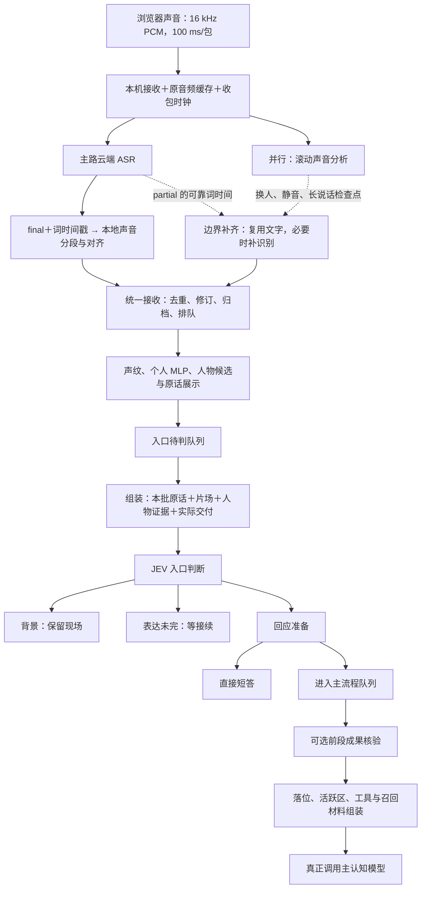

# 主认知前流程、输入输出与耗时

## 2026-11-09 22:15：四处修复后的完整录音复测

最新版服务PID36176，22:06:51启动。使用已收录“与gpt 的对话”同一60秒原声，原速进入正式服务，加载11条声纹，实际运行MLP、火山ASR、DeepSeek JEV、主认知和后续整理、火山TTS及Windows音频设备播放。完整会话ea43015b1a6b43f89a9eaa69b7a2e525，结果在[本轮记录](../work/gpt-full-service-20261109-220723/verification.json)，[原始事件](../work/gpt-full-service-20261109-220723/events.jsonl)，[实际模型请求与返回](../work/gpt-full-service-20261109-220723/actual-jev-prompts.json)。后面的旧复测段落是历史记录，其PID和“最新”表述仅指当时。

### 改动与实际验证

1. **同人碎片合并。** 05配词后相邻同一可靠声学轨道、无重叠、间隔不超过1.5秒的片段合并；实名候选冲突不强行统一。后到ASR一个final里即使包含多人，也逐段核对已交付输入，在同一声学轨道内按原输入编号合并，不把另一人的话并入。场景文字、声音起止、音频引用和页面都更新，旧片段保留为折叠证据；迟到的页面分组不会再次把整句拆开。本轮“好听到了那就按你说的来累了就 / 先歇会。 / 别硬撑 / 我们就停在这你休息好了再叫我”四条，在录音开始后15.17秒合成一条。最终文字仍有一个句首逗号，是原配词标点归属遗留，不影响合并，但不宣称转写完全正确。
2. **补标点不作废判断。** 同一输入的普通逗号、末尾句号及词面已明确为问句时补问号，视为等价修订。否定断句、引语、数字、会改变疑问性质的标点仍保守处理；实质错字沿用JEV修订复核，不按“只错一字”直接吞掉。录音目标句发生真实补标点修订，只进行一轮JEV、播放一份正式回答。此轮标点在JEV开始前约6.5毫秒到达；另用同一原文在调用进行中注入修订的回归，验证结果不会失效，不能把前者冒充调用中场景。
3. **催促继续不当停止。** 提示词明确区分“怎么停了，你继续啊”与“别继续了”。程序在停说控制执行前保护已判定面向匠石、句末明确肯定继续的请求，否定和引语不覆盖。本轮“就这么停啊？你给他问他一个，你继续啊。”得到keep+prepare，并实际回答“行，那我接着来。刚才有人提到累了想歇着，就不再追着问了。”未发生误停。
4. **简单问题直接答。** 提示词把一句话可答的假设、选择、感受纳入现有短答范围，要求转主认知时指出具体缺少的材料或任务。第一次复测发现JEV已选短答，下游却因为声学分批collection_complete=false又转主认知；现已允许JEV明确complete且无pending_refs时按短答交付，原有交往、人物与播放许可仍复核。本轮目标句确实走self_reply，main_called=false，回答“我会把声音放轻，安静陪一会儿，不追问，也不催你说话。就这一个动作，给你留个不吵的余地。”同次录音的接续请求仍运行了真实主认知。

### 速度：同一句的正式回答

目标句为“匠石，有人说我有点累，如果不让你安慰，只让你做一个动作，你会做啥？”。计时从这条输入末尾音频实际收包，到Windows播放开始回执；回执为成功提交首个音频缓冲，不冒充扬声器物理出声测量或浏览器绘制时间。回复不回灌麦克风。

| 同一录音复测 | 正式回答开播等待 | 路径 |
|---|---:|---|
| 21:34，上一轮 | 9.499秒 | JEV修订重判，再进主认知；6.139秒的“嗯，我想想”不是正式回答 |
| 22:07，最终版 | 5.328秒 | 一轮JEV，两次模型调用，直接答；无重复正式回答 |

本句减少4.171秒，约44%。以录音固定39.8秒位置发送时刻作为共同起点重新核算，分别9.505与5.335秒，结论一致。当前上下文和云端响应未冻结，不能推广为所有对话固定快44%；下午13.880秒、上午7.885秒仍作为其他时段参考，不只挑最慢基线。

本轮5.33秒约由：末尾音频到首次文字交付1.11秒；JEV入口2.09秒、回应准备1.47秒；回复发出到设备开播0.35秒；其余材料准备、调度和交付约0.31秒。生成后发出只约7毫秒，未再出现生成完成后空等数秒。两次JEV仍是串行，是这句当前主要耗时。

### 还卡在哪里，哪些没有被这次消除

- “你继续啊”虽不再误停，仍用了8.287秒才开播：JEV共3.533秒，主流程2.426秒（其中主认知1.837秒），发出到开播0.608秒。准备判断以“keep且有延续事项”为由转主认知。识别、人物证据、材料和交付占其余时间；这是接续路径的剩余慢点，不宣称所有简单话都已直答。
- 本轮16次入口判断中，只有两次进入回应准备。最终合并前，四个早到碎片中的三条已经各走过入口判断；这次解决最终整句和重复输入，不保证早期没有碎片判断开销。第四条在合并后2毫秒被判旧来源失效，随后合成整句成功重判为背景；它不是7秒模型超时，也不是补标点导致失效。
- JEV队列中位46毫秒、最长1.819秒；06窗口计算中位32.8毫秒、最长85.9毫秒；04/05整批处理含对齐中位106.1毫秒、最长224.3毫秒。声纹13次中位139.9毫秒、最长291.0毫秒；MLP20次中位100.3毫秒、最长239.6毫秒，分别另复用20/28次。这轮局部模型未出现数秒阻塞。
- 07队列最长1.302秒，单次补识别最长0.823秒，整次取字工作最长1.039秒。没有复现先前7秒等待；这些是不同样本的最大值，不能相加虚构一次等待。仍有13次空结果、9次限流，含录音之后等待阶段，不能直接当作说话期间无效比例。
- 事件循环最长迟醒503毫秒，仍有短卡顿，但这轮未出现此前数秒冻结。背景写场仍会继续十余秒，未计入当前回答开播等待。

### 验证与范围

六组相关Python回归140项通过；其后针对同一录音的“判断进行中补问号”增加一项，所在文件29项全部通过（该29项包含此前已通过项，不重复相加）。三项页面脚本通过，覆盖合并后旧分组更新、生成/开播/播完分离与延后回执归属。未声称项目全量测试通过。提示词当前全文、长度表、索引和真实调用例子同步更新。未启用新的独立倾听模型，也未更改已约定的8秒窗口/1秒提前分析节奏。

## 2026-11-09 21:42：用户指定录音的两轮完整复测

使用已收录“与gpt 的对话”的同一60秒原声，原速100毫秒一包进入正式服务。实际加载11条声纹，并运行MLP、火山ASR、DeepSeek JEV、主认知及后续整理、火山TTS和Windows音频设备播放。没有用假模型代替；设备提交和完成回执不冒充浏览器绘制回执或声卡物理出声测量。输入为录音，不将回复通过麦克风回灌。

最新服务PID11908，21:34:16启动，第二轮使用修订排判去重修复。第一轮会话d5834ad50b0e4eef818cda898e7e6f22，第二轮5cf8fa54466345ff84dd6a9d6ee0d3ff。下午基线为1856b638a417402485db061e9b5cc18d，上午参考为48619fc24d804607989820584a2759a0。人物库、当前上下文和云端速度未冻结，基线加载12条声纹，本次11条；因此是同音频的实际观察比较，不是只改变一个程序变量的严格A/B，也不是总体速度结论。

### 同一句长问题的真实出声

“匠石，有人说我有点累，如果不让你安慰，只让你做一个动作，你会做啥？”计时从该输入末尾音频的服务器实际收包时间，到设备开始播放回执，不用累积音频时钟偏差代替等待。

| 轮次 | 正式回答开始 | 过渡回应开始 | 是否重复正式回答 |
|---|---:|---:|---|
| 上午08:33参考 | 7.885秒 | 无 | 此输入一份 |
| 下午15:03最近基线 | 13.880秒 | 无 | 此输入一份 |
| 本次21:27第一轮 | 7.215秒，第二份15.661秒 | 无 | 是，两份均实际播放 |
| 修复后21:34第二轮 | 9.499秒 | 6.139秒，“嗯，我想想。” | 否，一份正式回答 |

第二轮比下午正式回答快4.381秒，约31.6%；仍比上午慢1.615秒。第一轮7.215秒不能充作修复后保证，因为那轮还重复回答。

第二轮目标句分解：末尾音频到首次输入文字发送1.024秒；文字准备好到主流程开始约4.521秒，其中一次旧JEV因修订作废耗1.443秒，重新完成的JEV耗2.700秒；主流程3.605秒，其中主认知3.503秒、组装0.019秒；正式回答生成后约0.006秒发出，再约0.395秒开始播放。各指标起点略有区别，且主流程收尾与出声准备重叠，不能简单相加当作另一条精确总时长。过渡回应与正式回答分别保存，未把“嗯，我想想”当作答案。

### 实测发现并修正的重复排判

第一轮同一输入08209c5dcd394408904bfe51c3c0f35d：21:28:13.203原任务入队，13.208修订，13.214修订任务再次入队；第一份任务已读到修订文字，第二份任务仍把同版文字再判一次。随后生成两个正式回答，并分别在录音相对47.031秒、55.477秒开始播放。不是ASR产生了两次新输入，也不是同一音频包被设备重播。

修复：同一输入在文本实际变化时增加修订版本；完成有效判断后记录它实际使用的版本及文字。后排的修订任务若对应同一个已判断版本，消掉重复工作并记录voice_revision_already_judged；真正的新修订、失败/过期判断、发生中间实质修订后又改回原文均不直接跳过。版本仅用于程序内部，不加模型字段或调用，不改变现有system/user与Schema。

已用真实长问题文字构造“修订先更新文字、归档尚未结束、第一任务先读取新版、修订后追加”的交错回归；同时验证改成另一条命令后又改回旧文字仍会正常判断。相关112项通过。第二轮同一长问题只有一份正式答案，但这轮时序是旧JEV先开始、后被修订作废，未再次触发第一轮的同版本竞态；故第二轮不重复是观察结果，专门交错回归才是该竞态修复的直接覆盖。

### 各段耗时与真实调用

| 指标 | 下午基线中位/最大 | 第二轮中位/最大 | 样本说明 |
|---|---|---|---|
| 04/05实际处理 | 130/448毫秒 | 36/380毫秒 | 各9次，含按需声纹等 |
| 声纹执行 | 106/217毫秒 | 94/140毫秒 | 26次→13次，非固定同样调用 |
| MLP执行 | 80/274毫秒 | 58/183毫秒 | 42次→21次 |
| JEV出队前排队 | 1.133/4.300秒 | 0.278/3.028秒 | 18→17条出队，含修订 |
| 每轮JEV | 1.605/3.340秒 | 1.572/3.194秒 | 各15轮，含背景的一阶段和回应的两阶段 |
| 主流程 | 3.225/5.263秒 | 3.605/6.017秒 | 各3个完成活动，内容与档位不固定 |
| 主认知步骤 | 3.080/4.500秒 | 3.503/5.407秒 | 不能据此说主认知变快 |
| 07队列 | 0.0013/0.625秒 | 0.0016/1.036秒 | 含收尾；与ASR请求时间分开 |
| 07单次补识别 | 0.448/1.994秒 | 0.482/1.141秒 | 各20次，包含空结果 |

第二轮声纹已有结果复用15次，MLP复用22次。06滚动窗口整轮（含收尾静音）执行中位32毫秒；未将收尾静音都算作原录音声学样本。此次未重现07单次请求7秒长尾，但仍有16次空交付、6次限流记录（含收尾），不能说补识别已没有浪费。空结果冷却缩短的收益未通过固定响应时序A/B单独测量。

### 整句与仍失败的项目

- 目标长问题：03原包33.712–40.292秒，04/05保留一条，07提前交付34.552–39.732秒的文字；后到主路带标点修订原输入。两轮都没有再新增“匠／石／啥”三个单字输入。
- 前半段仍有碎片：07先提交“好听到了那就按你说的来累了就先”“歇会。”“别硬撑”“我们就停在这你休息好了再叫我”。最终03是3.332–13.852秒的35词包，04仍有多个声音/时间片段；合并阶段逐个旧输入修订，没有将这四条整体收拢。整句保护目前主要覆盖已经判定保留的单行，不覆盖这类一个final含多个声段与多个提前输入的全部组合，因此未通过“所有长句都不零碎”的验证。
- “你继续啊”第二轮被JEV判为stop+background：模型理由把“就这么停啊”解释成停止当前表达，因此没有针对这句回应。是接话判断错误，不是声纹计算慢。
- 第二轮长问题补逗号/问号仍让旧判断失效1.443秒：当前等价规则对含否定、数量及问号变化保守，需继续区分“补齐原有问句标点”与真改意，不能一律删标点规避。
- 简单假设问题仍走主认知：第二轮回应准备给出的理由仍是“需展开理解与简短回应”。当前提示词的短答倾向没有稳定达成；不将“模型已改用短答”作为测试结论。
- 第一轮还有一次模型多输出空why_note导致整批拒绝；第二轮未复现。没有将格式失败隐藏或计作正常快答。

原始记录：[第一轮](../work/gpt-full-service-20261109-212727/verification.json)、[第二轮](../work/gpt-full-service-20261109-213452/verification.json)、[下午基线](../work/gpt-full-service-20261109-150300/verification.json)。各目录保留events.jsonl、diagnostics.json、history.json、latency.json、analysis.json及实际回复音频；verification中的每个reply_id可对照生成、发送、开始、结束时间。多个输入共享同一reply_id时只是一份批次回复，不按输入数重复计数。

以下为此前版本记录。

## 2026-11-09 21:15：局部重叠整句保留、修订与播放时钟

当前实现覆盖此前20:27版未覆盖的中部重叠：ASR已给单声音分组、本地清晰部分只有一种声音时，局部空档或重叠均只标注不确定，保留原句。确有两种清晰声音或ASR已标整段重叠时，不强行并成一个人的话。两路合并继承整句标记；保留局部重叠范围，不扩大实名证据。

同一输入的标点等价修订直接更新原文字，不再次排判，也不使进行中的入口判断或主认知准备失效。已播事实保留。其余错字不以改字数判定：原有JEV读取修订和回应状态；已有已播回应且意思没变则不重复回答，实质变化仅纠正受影响部分；无法直接确认等价的未播回答仍按原有保守规则作废并重判，不承诺所有错字均原样保留待播回答。

页面分别显示生成、开始播放、播完（北京时间，毫秒）。开播取浏览器音频节点启动时，播完要等全部音频及段结束；不是服务器生成时间，也不是声卡物理出声测量。新增浏览器显示回执及播放时钟记录，后续可区分服务器完成与页面收到/绘制；刷新页面后使用新显示，不能补造旧记录缺失的时刻。

20:47“好了，你走开。”的历史出声等待12.903秒：末尾音频20:47:02.798送达；06在03.183交07；07第一轮03.186–03.742正常结束但无文字；06.094才重排，06.098–06.875取得文字，07.054完成输入；JEV约07.428–10.466（3.038秒）；主流程10.666开始，耗4.475秒，其中落位0.551秒、组装0.026秒、主认知3.817秒；回复15.085发送，15.701开始播放，21.028播完。各阶段存在少量重叠，不把阶段总和当作精确总等待。

已缩短07成功空结果的重试冷却：2秒改0.5秒，仍由下一次06调度触发；网络/服务异常仍2秒，每段最多两次及全局限流不变。此次旧记录空结果后约2.352秒才重排；改动能减少人为冷却，尚无新版真实云端测速，不能声称总等待已减少固定秒数。

20:39:58的“匠石，有人说你笨。”在20:41:02.222被ASR旧结果批次改为“匠石有人说你笨”，两次ASR到达相隔约64秒；该晚到批次本地排队仅0.95毫秒，随后约46毫秒开始处理这一句。晚到发生在进入本地结果队列之前；现有日志不足以分清云端何时生成、网络何时送达和事件循环何时读取，不能据此认定云端或网络故障。现在该例不会再次回答。

验证使用保存的原文、声学边界和响应时刻做回归；部分词块为按记录构造的测试输入，不是重新运行原声声学模型或完整云端回放。20:46:43“也不知道是谁，这么欠打。”中间约472毫秒重叠，现保留一句、人物待定。最终合并相关回归111项通过；页面三项脚本通过。

以下为各阶段历史版本记录；若与本节冲突，以本节当前实现为准。

## 2026-11-09 20:27：整句保留与短答选择修正

已实现：ASR已有单声音分组、本地清晰部分仅一种声音时，中间覆盖空档不再自动拆出独立碎词，保留完整原话及不确定区间。中间明确重叠或存在两种清晰声音仍分开；原有开头重叠保护继续保留。此处依据声学证据与ASR分组，不额外调用语义模型猜测谁说了哪个字。

两路合并继承整句标记。原先提前交付的同一声音输入均落在最终原句范围内（输入关联容差150毫秒）时，按原输入编号整体修订，可合并多个同声旧输入，不再按字中点新增边缘字；重复最终包不重复修订。修订仍明确局部人物证据不确定，不扩大已有实名声纹证据。不同声源或超出原句的旧材料不强行整体合并。

测试使用“陆”457.511–457.551秒、本地起点457.543秒和既有输入范围，后半句词块为测试构造；另构造同声中部空档及多旧输入合并用例。相关93项通过，会话层不确定证据补充与JEV回归66项通过（两组有重叠，不相加）。真实长段原声的声学空档成因仍待回放，不将这些测试写成完整真实录音复测。

JEV回应准备提示词已改：许可满足、当前材料足够的简单问答和简短反馈优先直接回答，不因需要理解当前上下文就转主认知。核查、执行、缺失历史、形成约定和实质分析仍走主认知。固定system及说明性例子净增161字符，user组包与Schema不变，对应5份当前全文及索引已同步；新提示词真实效果尚未测量。另记录模型选择短答却被程序挡下的具体条件，写入现有stage_records，不发送给模型、不增加调用。

## 2026-11-09 17:31：6秒提前认人、补尾巴复用（代码与测试已完成）

- 06仍每新增约1秒分析最近最多8秒声音；04有ASR最终结果时直接读取缓存、按需补缺口，不等待06定时器或07取字。
- 单人持续讲话约6秒：提前并行做声纹和MLP，只准备人物证据；尚未结束时不因6秒时长启动07补识别或正式JEV。
- 例如0–6秒已认人，6.6秒ASR返回：04补剩余声学范围；若共享分段证明仍是同一清晰声音，声纹和MLP沿用先前结果，当前文字及音频范围仍更新到6.6秒。前次任务尚在运行时共享该任务，不再提交一份。
- 中途换人、重叠或分析覆盖缺失：不能跨过去复用。声纹未取得可用结果、相关模型/门槛变化或MLP标签更新，允许重算相应一侧。已分析的同人短暂停顿本身不强制重算。
- ASR最终结果或06识别到声音结束边界后才取字；换人产生前人的结束边界时可先处理前人。后到的同一段音频继续按稳定输入编号更新，保留既有回应处理规则。
- 取消6秒文字检查点后，累计声学快照保留至共享缓存120秒范围，避免长话前部被原16秒快照截掉；这是有界缓存，不宣称无限保留。
- 人物证据若复用，模型侧basis明确说明“同一连续声音沿用前段人物证据，未重新比对新增尾部”，不把沿用当作新匹配。

验证：相关回归114项通过，新增长话边界、ASR直接交付及模型证据来源用例后针对性29项通过（两组有重叠，不相加）。覆盖6→6.6秒不重复认人、正在运行任务复用、短暂停顿、换人/重叠/覆盖缺失禁止复用、版本变化、18秒未完话不送正式JEV、03最终结果可直接交付、20秒长话保留起点。尚未用这一版重跑完整云端流程；下方15:03耗时是历史版本，不能作为这次修改后的速度结论。

### 当前交谈对象与轻量倾听：已确定范围，尚未启用

只服务倾听，不建立通用关注系统。应在已确认对匠石说话后关联当前声音，允许姓名未知；背景人开口不自动抢走此状态，明确换了交谈对象、结束或过期后再更新。人物是谁仍由声纹、MLP及原有证据判断。

设想的触发是：当前交谈对象长话中，约6秒附近出现可理解的稳定短句和自然停顿，才提前理解；6秒不是硬切点，逗号本身也不证明现场有可插话的空隙。轻量结果只允许继续听、简短中性回应或表情，不直接触发正式主认知，也不宣称对方讲完。对方已继续说、正式输入已到或结果过期时，不补播迟到的语气词。上述独立倾听调用和播放保护尚未接通，不能当作当前已有效果。

复测（2026-11-09 15:07）：同录音完整跑两轮，当前04中位130毫秒、目标句文字到JEV约0.29秒；总出声分别9.67/13.88秒，并未稳定快于此前7.88秒。后一轮回答生成后因player_busy再等6.10秒；另有短句声学边界迟迟未出的问题。见[实测与剩余卡点](滚动分段资源与提前处理方案-20261108.md)。

更新（2026-11-09 14:58）：程序已接入04补缺口重置06节奏、窗口边缘保护、累计分段共享、声纹/MLP并行及07空结果重试。详细触发条件和等待上限见[当前实现](滚动分段资源与提前处理方案-20261108.md)。下方此前实测耗时保留为历史对照，不当作本次成绩。

整理日期：2026-11-08（北京时间）。正文早期耗时表使用 **2026-11-07 18:29–18:36**；下面补充定位已纳入 **11月8日21:03–21:39**，两窗口不要混用。本轮更新流程解释；修复及验证记录见[晚间核对报告](语音实测与接话异常-20261108晚间.md)。

更新（2026-11-09 08:38）：正式服务完整回放已完成，见[完整回放与07等待拆分](滚动分段资源与提前处理方案-20261108.md)。04是共用分段服务的按需入口，final到达即取缓存或补缺口，不等待06下一次触发，也不等待07云端取字。正式负载下04/05含声纹匹配中位171毫秒、最大380毫秒；目标长句末尾音频到实际开播7.88秒。07旧7.36秒主要是06未及时给出短句结束边界，约6.64秒，不是请求本身卡7秒。JEV前排队与非必要修订重判仍有长尾，不能以这句恢复回应代表全部问题已消除。

## 11月8日补充：四个问题在流程中的准确位置

1. **7秒超时**：第一次入口模型调用 `voice_jev_entry`，不是第二次回应准备 `voice_jev_prepare`，也不是主认知或语音播放。日志缺网络分段计时，不能认定为纯网络故障。程序仍可设计受控等待、失败状态与备用通道，需评估漏答和成本，尚未实施。
2. **新旧话关系**：新文字在进入JEV队列时，也通知 `EntryScheduler`。旁路比较旧话与新话，给旧工作继续、暂挂或停止建议。main已有入口进行中的关系判断；当前扩展了主认知/播放忙碌时的关系判断，并接上 `TurnSchedule`。观察模式仍修改待处理状态、进而堵住播放，是扩展连接的缺陷，已修复。它与06–07声音补路不同。
3. **重复单字**：03最终文字 → 04分声音 → 05词时配声音 → `compare_evidence`核对冲突 → 08两路汇合；06滚动边界 → 07复用03临时文字或补识别 → 同一个08。截图整句先由07交付，主路后来被拆细，08基于音频覆盖的去重漏掉边缘三个字。整句关联已接入：保留final原包，以原声范围与稳定输入编号更新原输入；目标录音已复测，详见《滚动分段资源与提前处理方案-20261108》。
4. **背景转等待**：第一次JEV返回 → 解析与冲突纠正 → 背景/等待绕过回应准备（准备分支需调用第二次模型）→ 外层 `_judge`检查有效性并调用 `enforce_completeness` → 最终路由。背景未完话就在最后这个本地保护函数被错误改为等待。该函数main已有，不能说是新增关系模块的模型决定；已修复背景保留规则。

### 同一份声音，两路配合的边界

- 03发给04的是最终文字、词时和原声范围；04按范围读取06共享声音分段，已取消独立分人；只有缺口由共用服务补齐。不是“03只发停顿信号”。云端final不是语义完整的保证。
- 04输出声音时间段、重叠信息和声纹证据；05按ASR提供的词块与声音段的时间重合分配归属，中文词块可能是单字。单个词不会因此多调用一次模型。
- 05可靠门槛示意：词长100毫秒，声音A覆盖80、B覆盖10、A不重叠，可配A；A覆盖60、B覆盖40，则保留不确定。实际门槛最佳覆盖至少65%、第二候选不超过20%；单一非重叠声音覆盖整话80%可走整条快捷路径。
- `compare_evidence`是本地证据核对：云端给单一声源、本地却拆成多个，记录冲突并保持身份不确定；它不判断是否应该接话。后续人物证据整理及JEV仍有自己的任务。
- 06每新增约1秒分析最近最多8秒原声；07接受非重叠且至少160毫秒、已结束300毫秒或达到6秒检查点的未覆盖片段。还有去重、尝试次数、积压和请求速率限制，不能把这些阈值当必然交付时刻。
- 07先从03已有临时词时取字；可用时不增加ASR调用。否则独立识别指定原声。07不必等03最终结果，也不再串行走主路04/05；只暂定声音关联，不直接确认实名。
- 03、06可以重叠执行；04、06各有分析工作并共享本机资源。04不直接复用06结果。补路抢先交付后的主路结果必须在08关联回同一次发言，不能再当成新说了几句。

### 建议的解决顺序

已完成：观察模式不得改变执行权限；背景半句不得自动转等待；每次重排独立计时；记录待播原因。尚未完成：主路原始整包与补路整句关联，随后才分人及处理差异；JEV超时对队列的隔离或备用策略。只保存接续材料不能自动取得阻挡旧回答的权限。保留、替换、取消要明确写出原因与已播部分，并把简短结果交给后续上下文。

本轮画布分别提供03–07模块选择、JEV本地检查位置、新旧话main/缺陷/修复对照、截图真实事件逐步查看。示意“天气改地点”等例子已明确标为机制示意，未冒充实测。

可编辑图：[JEV 之前](主认知前流程-JEV之前.drawio) · [JEV 到主认知](主认知前流程-JEV到主认知.drawio)。

## 先区分三个边界

1. **识别有文字**：云端返回文字，可能只是临时结果，还可能包含多个人的声音。
2. **JEV 可以判断**：原话、声音归属线索、必要上下文已经整理成一批；不要求先确认真实姓名。
3. **主认知开始**：JEV 允许进入主流程。主流程还要落位、读取材料和组装请求，之后才真正调用主认知模型。

日志的 `main_started` 是第 3 步的**主流程启动**，不是模型首字输出，更不是用户听到声音。“背景”“等待接续”“直接短答”都可能不经过主认知。

## 一、总关系

实线是主数据流，虚线是并行证据或补救。滚动分析与主路 ASR 并行，不是每一句都要再做一次补识别。8 秒滚动窗是回看范围，不等于每句话先等 8 秒。

对同一条普通 final，顺序是：03 识别返回 → 按该条起止时间截取缓存原声 → 04 本地声音分段 → 05 将词时间与声音段匹配。03 的网络结果接收由独立任务继续推进，后续结果最多缓存 64 批；当前对齐未完成时，下游仍按顺序等待消费，并非云端识别必须停下来。06 则按音频进度独立触发，不等待 final；04 与 06 使用独立分析器，可能重复分析同段原声，06 的结果目前不直接替代 04。

05 的实际规则：仅一个非重叠声音段且覆盖原话时长至少 80% 时，可整条归属；否则需可靠词时并逐词匹配。最佳声音段须覆盖该词至少 65%，第二候选不得超过 20%，且最佳段不标记重叠。文字与词序不一致、词时不完整或归属竞争时保留不确定，不凭文字意思猜人物。整体识别修订另走引用重映射分支，不保证每次重做分段。

## 二、JEV 之前：逐模块展开

| 模块 | 主要输入 → 输出 | 作用与关系 | 技术与等待边界 |
|---|---|---|---|
| 1. 浏览器采集 | 麦克风波形 → PCM、声级、开始/结束事件 | 连续送声音；声级只说明“有声音”，不判断是不是对匠石说话 | Web Audio、AudioWorklet；转成 16 kHz、16 位小端；每 1600 采样即 100 ms 发一包。100 ms 是包长，不是识别耗时 |
| 2. 本机接收、缓存、时钟 | PCM 包 → 连续原音频、音频偏移、实际收包时间 | 同时给 ASR、分人、声纹、补识别使用；时间线用于查延迟与取对应原声 | aiohttp WebSocket、Python asyncio、SessionAudio、AudioReceiptClock。音频偏移与绝对时间分开保存 |
| 3. 主路 ASR | 连续音频 → partial、final、原话、起止时间、可用的词时间戳 | 把声音变成文字。final 只表示这段识别结果可提交，不等于人已经把意思说完整 | 最新日志 backend=online，即火山流式 ASR；也支持百炼、Deepgram及本地替代路径。火山配置结束静音窗默认 500 ms，但这不保证 500 ms 得到最终文字 |
| 4. 本地声音分段 | 原音频 → 说话人时间段、重叠区、声纹线索 | 区分“哪段是谁的声音”；这不是把重叠声音分离成两条干净音轨 | sherpa-onnx 的离线说话人分段接口、pyannote 分段模型、可选 CAM++ 等声纹嵌入。具体所选声纹型号应以启动配置为准，不能只凭默认值认定 |
| 5. 词与声音对齐 | ASR 词时间戳＋声音时间段 → 按声音拆开的 Transcript | 避免把多人一整段话归给同一个人；缺词时、重叠或对不上时，保留归属不确定 | CloudSpeakerAlignment、区间重叠匹配。**1.2 秒是慢进度提示门槛；超过后继续等同一个任务，不是硬截止**。这一段可能拖住后续云端结果的接收处理 |
| 6. 并行滚动分析 | 最近音频 → 连续声音边界、临时声音关联 | 主路迟迟不结束时，也能发现一段话结束或换人；不直接决定回应 | AudioTimeline、独立单线程执行器、TrackLinker；默认回看 8 秒，每 1 秒推进；只保留一次在跑任务与合并唤醒，避免每包排一个重任务 |
| 7. 边界补齐与补识别 | 边界＋尚未覆盖原声＋已有 partial 词时 → 补充原话或修订 | 优先截取主路已经返回的可靠词时，不够才另开识别；最后统一去重 | RecoveryIntake；结束后 300 ms 静音可触发，长说话 6 秒检查点；待补队列最多 8 段，额外识别最多 20 次/分钟。识别结果收集有 15 秒期限，但开连接也可能另耗时；这些是保护参数，不是正常耗时 |
| 8. 统一接收与修订 | 主路/补路 Transcript → 唯一输入记录、修订关系 | 去除同一音频的重复回传；跨人整体修订不强行归给某个人；有意义修订仍需重新判断 | TranscriptAssembler、RecoveryIntake.publish、accept/accept_batch；OpenCC 简繁处理；原音频、原始记录留程序侧 |
| 9. 输入归档与工作队列 | 最终原话＋原声 → 可处理批次 | 保存本句原音频和收包时间；工作线程取到当前已准备好的句子，不再固定额外等“凑够 20 字/12 秒” | asyncio.Queue；录音归档在线程中执行但调用方仍等待完成，慢磁盘可能延迟入队；可选音源分离/重新识别走配置分支 |
| 10. 人物证据整理 | 原声、声音轨道、已有档案 → 声纹候选、身份置信、个人 MLP 结果 | “听出是同一声音”“声纹匹配实名”“语言中自报姓名”是不同证据；不能混成一次确认 | 声纹相似度及本地门槛、VoiceIdentities、个人分类器、SQLite 档案。个人分类任务可后台完成，等待预算默认 1.2 秒；它与第 5 步超时后的处理不同 |
| 11. 候选补充与展示 | 已有证据、短句音频、历史候选 → JEV 可用候选和页面显示 | 短句可重复拼接提取特征，但不增加独立证据；未确认姓名仍保留未知/暂归 | 短音频特征、候选排序、证据来源标记。档案查询、特征提取、归档和页面发送都可能累积在这一段 |
| 12. 入口待判队列 | 一批批原话 → 本次 JEV 批次 | 与页面展示分开；当前点名/控制输入优先，同声前文和接续仍一起处理；其他输入保留，老输入有等待保护 | 当前普通合批最多 6 条、约 1200 字符；不拆已经形成的单一大组。8 秒老化是优先级规则，不是“8 秒必完成”。没有取消已经在跑的入口模型调用 |
| 13. 入口材料组装 | 本批原话＋现场＋人物证据＋实际交付 → 最终 system/user 与 Schema | 为 JEV 提供判断依据，压缩内部 ID、重复证据；未播内容不能写成“已经说过” | JEVSceneStore、人物档案、相识记录、原话与播放回执、短引用映射、JSON Schema；本机同步读写是已采样到的阻塞位置 |

### 不应画成必经步骤的模块

- **声音活动检测/整句模型**：Silero VAD、Smart Turn、Namo 等为配置分支。当前默认 `utterance_material=False`，不能把每一句都画成先串行等完 Smart Turn 和 Namo。
- **音源分离**：与说话人分段不同；分段只是标时间区间，分离才试图拆开重叠波形。默认分离关闭。
- **个人声纹训练**：样本积累、训练与发布是后台工作，不能在图里误写成“每句话先训练模型”。
- **新旧话关系判断**：EntryScheduler 可在旧入口或主认知工作中并行调用撞车判断；是否真正暂停/取消旧工作由配置决定。只记录结果的模式不会据此阻塞旧工作。
- **前段准备**：可能提前做草稿或召回准备；主认知前核验其依据和可复用性，不等于又固定多一次完整主认知。

## 三、JEV 的输入输出与主认知关系

| 模块 | 输入 | 输出及下一步 |
|---|---|---|
| JEV 入口判断 | 原话、短引用、候选与证据、片场、实际播放、必要媒体和任务状态 | 人物归属及确定程度；交往 direct/uncertain/none；表达完整度；keep/stop/redirect；background/wait/prepare；本次处理及保留接续的原话引用 |
| 回应准备 | 已接受的入口结论、选中原话、同版现场、材料许可 | main/self_reply、L1/L2/L3、是否召回及查询句、是否带原图、可选短答/过渡语 |
| 主流程队列 | 通过 JEV 的 InputEnvelope | 合并合法待处理输入，读取最新修订；补实际交付与“保留/替换/取消”记录 |
| 主认知前组装 | 原话、人物、活跃区、相关工具、可选召回及前段成果 | 真正送给主认知模型的请求。组装时间不是模型推理时间 |

默认图按 split 展开：入口一调用，需要 prepare 才第二次调用。combined 可合为一次；decision 使用原生选择并可能回退，不可把所有模式的步骤简单相加。

3 秒无文字等待主要是**播放许可**的保护，发生在持续声音结束后等待识别；不是“主认知前必等 3 秒”。

## 四、一般耗时：用两个真实窗口说明

单位为秒。表中为中位数，括号是样本数。不同指标覆盖不同输入，**不能把一列中位数直接相加当作某一句的总耗时**。

| 测量范围 | 11-07 15:49–15:56 | 11-07 18:29–18:36 | 如何理解 |
|---|---:|---:|---|
| 本句末尾音频收包 → 结果进入统一接收 | 1.77（42） | 3.20（104） | 包含云端结束/回传、分段对齐或补路等路径；不是纯 ASR 推理时长 |
| 结果进入统一接收 → 最终文字发送 | 0.09（42） | 0.84（104） | 含本机处理和队列影响；不是浏览器绘制耗时 |
| 本句末尾音频收包 → 最终文字发送 | 1.84（42） | 4.76（104） | 前两段的逐句总量；晚间 P90 为 13.70 秒，最长 40.44 秒 |
| JEV 前材料准备 input_prepare_ms | 0.02（33） | 0.04（72） | 通常很短，晚间最大 2.47 秒；不能用中位数否认偶发阻塞 |
| 入口模型单次调用 | 2.15（34） | 1.80（64） | 包含失败调用；下午 6 次 error，晚间 1 次 error。不是完整两步 JEV |
| 回应准备模型单次调用 | 1.60（8） | 1.33（2） | 只有需要准备的输入才调用，晚间样本很少 |
| 主认知模型单次调用 | 2.27（5） | 3.28（1） | 已越过本图终点，列作参照；晚间 1 次不能当稳定水平 |

11 月 3 日和 5 日的入口诊断记录中，完整判断耗时中位数约 1.55、1.58 秒；批次中位数都为 1 条。11 月 6 日批次中位数为 3 条，判断耗时中位数约 2.59 秒。历史背景结果比例也很高，所以不能只用“背景话多”解释现在的恶化。不同场景、失败比例和统计口径变化，不能把这组数当控制变量实验。

没有独立计时的单个模块，例如纯声纹模型、纯分人算法、纯 SQLite 查询，暂不编造“通常几十毫秒”的数字。代码中的预算、窗口和阈值已在上表之外单独列明。

## 五、两个实际例子

### 例子 A：11-07 15:54，“石，你还在吗？”修订为“匠石，你还在吗？”

实际记录：

- 15:54:39 左右，初次 JEV 允许进入主认知。
- 15:54:41，原音频的识别修订到达，不是用户又说了一遍。
- 15:54:45.779，原回应“我在呢，匠石在。你说吧，有什么事？”已经生成。
- 15:54:51，包含修订句及背景话的一批被判为 redirect。
- 后来再次生成回应并排队播放；用户另一次重问也进入主流程。

当前代码针对修订明确区分：空白、末尾句号或句首逗号前“石/匠石”互改 → **保留**；其他内容变化 → **替换关联旧回答未播部分**；明确停说 → **取消**。记录最多三条、保留两分钟，进入入口、回应准备与后续主认知上下文。

要注意：这两次真实重问分别被分到 acoustic-34 和 acoustic-38，人物还只是暂归；因此不能声称当前“同一声音轨道去重”一定能合并这两次重问。不能为了减少重复，就把不同声音强行当成同一人。

### 例子 B：11-07 18:33，实际识别文字为“师你好。”

本句声音长度约 0.722 秒，按这条输入的相同时间链拆分：

| 阶段 | 耗时 |
|---|---:|
| 末尾音频收包 → 原话可用于处理 | 9.28 秒 |
| 原话 → 开始 JEV | 6.83 秒 |
| JEV 本轮跨度 | 4.49 秒 |
| JEV 结束 → 主流程启动 | 1.89 秒 |
| 合计：末尾音频收包 → 主流程启动 | **22.49 秒** |

主认知本次模型调用另耗时约 3.28 秒。按模型调用结束日志减去调用耗时反推，真正调用主认知模型约在 18:33:37.870；相对末尾音频收包约 **23.93 秒**。其中约 1.43 秒是主流程启动后到模型请求开始的前置工作。这是日志推算值，不是新增的独立计时。

这个例子说明：一句很短的招呼，长时间可能已经耗在模型调用之前。

## 六、目前卡在哪里

### 1. 本机事件循环阻塞：现在已有具体采样

晚间窗口有 35 条卡顿汇总，最大记录 **23.00 秒**；新增看门狗捕获 29 次堆栈采样：

- 14 次顶层在人物档案接口 `profile.py`：连接、读取人物、查询称呼。
- 3 次在相识资料接口 `acquaintance.py`。
- 3 次在声音分段 `segmentation.py:feed`。
- 4 次在 aiohttp 的 HTTP 解压。
- 其余在文件操作及 Windows 事件循环/接收调用。

这已经比“只知道卡了几秒”具体，但仍不是完整根因证明：同一次卡顿可能被采样多次；某线程持有 GIL、系统资源竞争、磁盘等待都可能影响采样位置。**采样次数不能当独立故障数，采样时长也不能直接累加。**

优先需要核查：事件循环上重复同步查人物与称呼、片场 JSON 落盘、逐音频包执行的 VAD，以及 HTTP 请求解压。将重任务移走之前，应保持原来的顺序、取消与引用一致性。

### 2. 分人对齐可能无硬上限等待

`complete_alignment` 超过 1.2 秒后只发“正在区分声音”的提示，继续等同一个任务。它保护多人归属正确性，但也可能挡住后续 final 的消费。需要单独记录“排执行器队列”“实际分段计算”“等待结果”三段，才能判断是哪一段慢。

### 3. ASR 与补识别的长尾

晚间末尾音频到结果接收中位数 3.20 秒、P90 10.89 秒、最大 33.14 秒。这里混有不同路径，不能全记到火山模型头上。补识别也会消耗额外模型调用与本机资源；主路词时复用可避免部分重复调用，但不能保证每次有可靠词时。

### 4. 入口排队仍是串行关口

当前已做点名优先、小批和同声接续保护，避免呼唤与大量无关话混成一批。但**正在执行的一次 JEV 仍会占住入口**。模型超时、分人延迟与本机卡顿累积时，后续输入继续排队。

晚间这一句“师你好。”在原话到 JEV 开始之间仍等了 6.83 秒。这个指标包含 JEV 之前的整理与排队，不能全称为模型推理。

### 5. 主认知前组装与播放要分开

下午 5 次主认知组装分别约 0.062、1.722、1.574、0.372、0.083 秒。更早的 23 秒组装异常没有在这五次重现，不能据此认定已解决。

TTS 连接中断、播放队列和“生成了却没播”属于本图之后，确实影响用户体验，但不应该混到“JEV 之前耗时”中。

## 七、代码与数据入口

- 采集：[voice_capture.js](../src/jshi/app/voice_capture.js)、[voice_ui.html](../src/jshi/app/voice_ui.html)
- 会话总流程：[voice.py](../src/jshi/app/voice.py)：connection、accept、_work、_judge_work、_turns、_respond
- 主路识别：[streaming_asr.py](../src/jshi/voice/streaming_asr.py)、[transcripts.py](../src/jshi/voice/transcripts.py)
- 分人及词对齐：[cloud_alignment.py](../src/jshi/voice/cloud_alignment.py)、[runtime.py](../src/jshi/voice/runtime.py)
- 连续分析与补路：[audio_timeline.py](../src/jshi/voice/audio_timeline.py)、[transcription_recovery.py](../src/jshi/voice/transcription_recovery.py)
- 接续与排队：[utterance_organizer.py](../src/jshi/voice/utterance_organizer.py)、[entry_queue.py](../src/jshi/voice/entry_queue.py)、[entry_scheduler.py](../src/jshi/voice/entry_scheduler.py)
- JEV：[jev_serial.py](../src/jshi/voice/jev_serial.py)、[jev_material.py](../src/jshi/voice/jev_material.py)
- 主流程：[process.py](../src/jshi/subject/process.py)
- 耗时与卡顿：[latency.py](../src/jshi/voice/latency.py)、[diagnostics.py](../src/jshi/voice/diagnostics.py)
- 实测数据：`.jshi/voice_latency.jsonl` 与轮转文件、`voice_diagnostics.jsonl`、`model_calls.jsonl`、`activity_timings.jsonl`、`subject.sqlite3` 的 histories。

