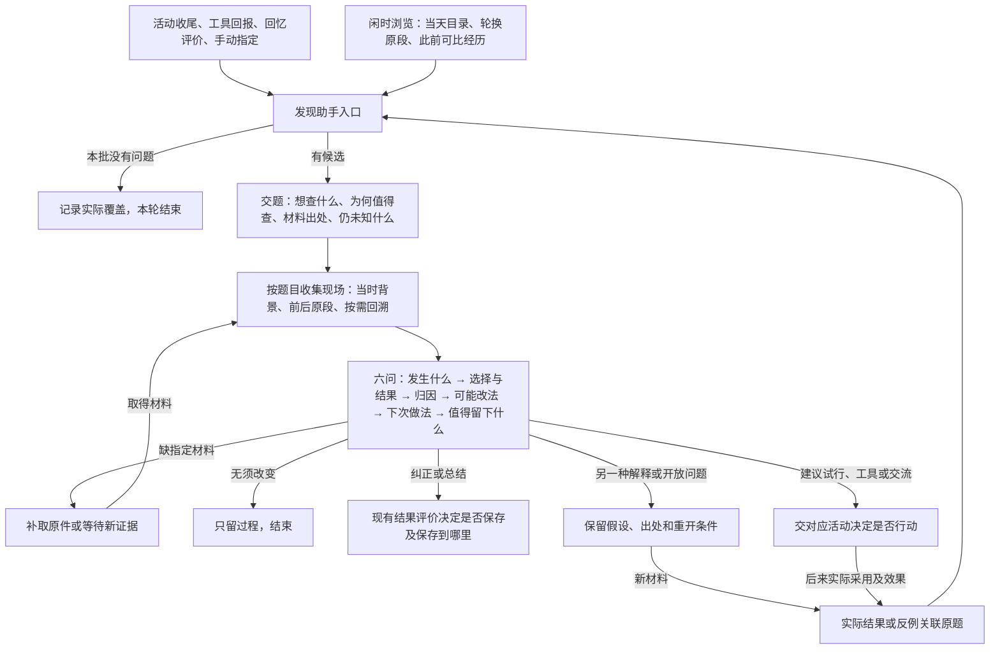

# 内在活动程序更改方案

程序基线为 `5d21289`。本分支已接入发现助手、按题取材、六问和旧题续办。概念和例子见[内在活动方案](./内在活动方案.md)。

### 如何运行本版

| 数据目录的参数 `INNER_ACTIVITY_MODE` | 一次闲时机会中会发生什么 |
| --- | --- |
| `0`（默认） | 新发生的工作走原自省流程。此前由新版接手的题、回忆和未送达的评价结果可以排完。 |
| `1`（影子） | 保持原自省生效，同时把助手的候选和看到的材料记在独立区域，供比较选题效果。 |
| `2`（采用） | 新问题先交给助手，再由现有执行器按题取材、运行六问。人工指定问题可以直接进入取材。 |

参数沿用该数据目录的 `param_overlay.json`。例如，一个全新测试目录可写入 `{"version":1,"values":{"INNER_ACTIVITY_MODE":2}}`。已有配置应保留其它参数并递增 `version`，再重启使用该目录的宿主。后退至旧模式也使用更高版本。原有 `INTROSPECTION_ENABLED` 总开关仍生效。

- **看普通交往。** 文字和语音宿主沿用同一后台执行器。`introspect-idle <主体>` 可手动触发一次浏览并执行一项。首版规则看过一页中的各组原话后，最多挑两个交谈问题。有七天内同人的可比原话或有明确后续回应时优先，同时给普通片段留出抽样机会。工具失败、出现异常后恢复均可触发回顾，普通成功任务按稳定任务编号抽样，重放时得到同一选择。每一轮主认知都可以不做标记。
- **指定一个问题。** `reflect <主体> "<问题>"` 同步返回认知。后续拿到原话时，可运行 `introspect-followup <主体> <问题编号或认知编号> <经历原段编号>`。后台用新证据续办原题。重复提交同一原段可以安全重试。对人物题会核对发言归属，准备播出的语音另待播放记录。
- **追踪试行。** 在同一条补证命令中，加 `--stage adopted` 可关联实际采用建议的原段，加 `--stage outcome` 可关联后来观察到的结果。一题有多条建议时用 `--suggestion next_time|tool|interaction` 指定。省略经历原段编号即可查看建议与已关联的事实。六问提出建议时只记录提议，实际采用和结果各自保留出处。
- **查证据。** 浏览的范围和位置存在 `reflection_memory.sqlite3`；正式六问在主体历史的 `introspection_done` 留下题号、当次引用映射、实际给模型的短码、待证问题及缺失项。P80-30 的检索反馈仍单独保留。一次回忆观察由创建时记录的处理者负责，再想的原件限定为该次主认知确实看到的原事件。
- **更换发现方法。** [发现助手接口](../src/jshi/reflection/discovery.py)接收原段、历史参照、工具结果或既有线索。通过 `SubjectProcess(..., discovery_assistant=...)` 可替换选题方法。当前版本使用规则，线上选题质量和是否需要本地模型仍待真样本评价。

**要交付的行为**：没人提醒、当天没有主认知标记时，匠石仍有机会从普通交谈、工具使用或回忆中发现一个问题。助手交出可追溯的问题后，内在认知直接围绕它收集现场，按原顺序完成六问。形成的纠正、总结、假设、学习需要或空结果分别有去处。后来有新事实，可以回到原问题。闲时调度、六问、回忆评价和结果接纳各只有一个执行责任方。

## 1. 正常运行路径

手动指定的问题已经成题，发现接口只做规范化与出处登记即可直通。主认知优先处理当场应答。后台复用既有闲时机会和单阶段执行预算。上图描述职责与数据流；六问可由一次模型请求完成，低档继续使用现有规则摘要与“未评”。

## 2. 发现助手的边界

用可替换接口承接现有触发源。接口接收主体及范围、触发事实引用、当天可浏览的活动目录和原段读取器、历史参照、旧题状态及已读范围，返回零到多项有顺序的候选，并记录这批实际看过的范围。**本次只约定输入、输出和失败处理；本地模型、排序算法、打分和训练留作专门讨论。** 首次接线允许用既有探测器的规则输出，或者在隔离验收中注入固定候选。原有检测能力之外的发现效果，需要真实样本验证。

- **候选最少信息**：主体、一个具体疑问、引出它的原段引用、推荐先看的缘由。可选信息包括人物与事项范围、方法建议、关联旧题、对照经历、参照缺失与未读部分。零候选是有效结果；读取失败要另记，以便重试。
- **扫描与取材分开**：发现助手取短材料决定“想查什么”；主模块接题后才收集能回答它的现场。可复用同一原段引用。已列目录、助手实际看过、六问实际可见分别计数。不能凭目录标题或一次召回来证明“每次都如此”。
- **时间与人物**：以主体配置的时区确定当日。此前七天是可替换的比较例子，排除今天，按同类任务、人物及情境比较，样本太少写未知。保留原话、工具实际返回、语音实际播放、旧事发生及今日想起的各自来源和时间。未确认人物不能被写入某个熟人的相处经验。
- **选择范围**：在已标记、异常或旧题之外，给尚未展现的正常、成功活动留下浏览机会。目录按来源分批，连续原话和同一次工具的请求、返回及重试应能成组取回。只有有限浏览时只报告有限覆盖；原件已经缺失就记缺失。

## 3. 六问的执行契约

复用 `IntrospectionRequest`、`build_scene`、`render_scene` 和 `IntrospectionAnswer`。接题就是开始收集；只有现场显示原疑问过大或前提不成立时才收窄，并把理由关联到原题。下表是程序需要支持的语义，提示词全文在实现改动时按项目约定同步。

| 原顺序 | 一般行为回顾 | 跨事或回忆题怎样用同一步 |
| --- | --- | --- |
| ① 发生了什么 | 还原对象、场景、前因、当时可见的事实 | 分别写清每段旧事及本次将它们联系起来的场合 |
| ② 我的选择与结果 | 分开记录实际选择、预期与实际结果 | 我想起或采用哪些材料，当时怎样理解；结果未观察到就写未知 |
| ③ 为什么 | 从自身、环境及偶然因素找证据，区分当时能知与后来才知 | 列可能的共同点、差异或反例；允许有多个解释 |
| ④ 能否更好、代价如何 | 比较当时可行的做法及代价，也可确认原做法合理 | 核对原解释是否需要修正，怎样理解更贴近原件，依据支持到哪里 |
| ⑤ 下次怎么做 | 保留条件与动作、工具需要、进一步交流三个已有出口 | 可提出求证、保持现行做法或在特定条件下试一次。实际执行、告知与效果分别回填 |
| ⑥ 什么值得留下或进一步评价 | 纠正、总结、自己的经验、与某人相处的经验，允许为空 | 可留下有出处的假设或问题，写清待证条件。一条假设不能因多次复述升格为事实 |

现场收集是六问前的已有步骤。已知原件就按引用查，找旧例才做内部召回，判断“这个范围是否都如此”则按范围取样并说明覆盖。三种方法可接续。补取限定于有名字的证据缺口；相同题、相同材料和相同缺口不能无限重跑。当前 `build_scene` 先取主体全部经历再裁窗，首版可保留兼容路径，新增按引用或带界限、分页的读取，优先查锚定原段。日浏览不可每次从头重读全库。

模型侧保持短引用 E/M/P 和必要的时间关系。原 ID、媒体引用、精确时间、来源版本和短码反向映射留在程序侧。在本请求内核对引用确实可见、人物归属明确；原事件不随新解释改写。已有低档不调用模型，未评与“已判断没有问题”分别记录。补材料、让路或失败也要留出不同状态。

## 4. 现有相似逻辑与迁移安排

| 已有代码及职责 | 更改方式 | 切换后只准谁产生效果 |
| --- | --- | --- |
| [触发源注册与合并](../src/jshi/reflection/sources/__init__.py) 的工具异常、人工修正、闲时选段；[活动收尾](../src/jshi/subject/process.py) 的 `_maybe_introspect_after_activity` | 原探测结果直接转换为助手输入。现有 `merge` 按一次检测的 `theme` 合并信号；跨天同题按稳定出处与新证据版本处理。 | 对每种来源明确使用旧或新入口。新入口生效后停止该源原来的自动入队。 |
| [六问原有执行链](../src/jshi/reflection/inprocess.py) 的 `_run`、[现场](../src/jshi/reflection/scene.py) 与[六问技能](../src/jshi/skill/introspection.py) | 扩展同一请求和现场以接受问题及原段引用，保留人工和低档行为。按问题调整第二、四问的观察对象。 | 同一题版本一次六问。复盘、比较、回忆是取材/判断方法，不为每种方式另设常驻模块。 |
| [执行器](../src/jshi/reflection/executor.py) 的 `tick/behavior`、[内存队列](../src/jshi/reflection/queue.py)、数据库 `thought_jobs` | 复用宿主线程、时段、预算、让路和登记表。旧 `behavior` 会先 `enqueue_idle` 再 `drain`，按来源切换时要连同这条兜底一起处理。 | 旧队列排完既有项，新题只进入一个持久执行阶段。分别记录选题优先级、到期时间及思考深度。 |
| P80-30.0 回忆评价与 `observations`、`feedback` | 保留实际可见/使用/帮助的评价和检索反馈。仅将有依据的 `needs_reprocess` 与理由转成题源。保留影子、关闭、空查询等既有限制。 | 检索评价仍在 P80-30.0 做一次；前置助手的优先级不会改写检索反馈。 |
| P80-40.0 回忆再加工与通用 P80-10.0 六问 | 旧任务仍按原阶段排完。新路线获准接管的回忆观察，按同一观察标识把原事件、可见集合及再想理由交给六问的回忆题分支，保留有效来源和关系依据。 | 同一观察、同一版本只选一个深入处理者。新六问不得在旧 P80-40.0 成功后再解释同一批材料。 |
| P80-50.0、[结果评价](../src/jshi/reflection/result_evaluation.py) 及 [`commit_review`](../src/jshi/reflection/memory_store.py) | 六问产生值得长期保留的认识时，走现有 `queue_behavior_result` 或兼容的回忆候选出口；继续使用多出口、额度、样本取舍以及事务提交。 | 选题排序与认识接纳各做一次。待验证问题与只留过程均无需再走长期认识评价。 |
| JEV、主动审视、工具通知、400 分析、学习与做梦 | 当场对外回应仍归主认知。`think`、写场、`next_jev_note` 继续保留现场含义。有效性分析做跨样本统计与调参判断。学习候选可建议实践，做梦仍是另一项设计。 | 后台读同一事实；不会重复调用工具、抢走通知、自动联系用户或直接改人格。 |

`P80-10.0/30.0/40.0/50.0` 都是已有完整请求。上表描述将来的路由。发现助手还没有确定需要新的模型调用；先不分配虚拟提示词编号，也不为方法名另建提示词。

**回忆交接的事务边界。** 目前 `ReflectionExecutor.evaluate` 通过 `finish_stage` 把观察转入 `reprocess` 或 `done`。切换时为每条观察固定深入处理者。旧处理者照常推进；由新版接手且确有再想理由时，在同一 SQLite 事务校验观察仍在预期阶段，保存评价与检索反馈、写入按观察和版本去重的交接记录，再把该观察的旧阶段置为 `done`。事务失败全部回滚。新队列满则交接记录保留“待投递”，按同一键补投；没有再想理由则只结清观察。助手随后放下候选，也不会让旧任务复活。已有对外评级投影按活动标识补写。

**回忆证据的门槛。** 沿用再加工对 `reflection_insight` 的种子排除：回忆题至少要有一个本次真正可见、可追到原事件的合法引用。若只有旧自省认识，结束本次深入加工。这个分支禁用以本次六问答复自身充作独立来源的回退；人物只是被提及或身份未确认时，不得据此接纳特定人物经验。

## 5. 程序接口、存储与失败恢复

以下是拟新增或扩展的最小契约。沿用 `src/jshi/reflection/`，在 [SubjectProcess](../src/jshi/subject/process.py) 的现有装配点注入发现助手和存储。继续使用本主体已有的 `reflection_memory.sqlite3`。

| 改动位置 | 拟议接口与数据 | 对旧调用的影响 |
| --- | --- | --- |
| `reflection/discovery.py`（拟增）、[`port.py`](../src/jshi/reflection/port.py) | 定义发现助手协议，如 `discover(context) -> batch`。批次含有序问题、原段覆盖和待继续的位置。沿用 `IntrospectionRequest` 原有主体、对象、来源、紧急程度和投入档位；新增可选的问题引用、证据引用集合及原题版本。 | 原调用缺少新字段仍按旧信封取材。人工直接交题无需本地模型或周基线。 |
| [经历账本](../src/jshi/experienceledger/port.py)、`scene.py` | 对已有 `list_experiences(after_sequence=...)` 补充按稳定引用和范围取原件的有界读法，分别支持现有后端；用 `render_scene` 统一映射可见材料。语音素材只通过已有关联读取。 | 为发现扫描使用独立游标，保留主认知、写场和记忆消费者原游标。内部召回统一进入已有内部读取语境，即使异常也恢复，防止读取又产生自省。 |
| [工具反馈](../src/jshi/tool/hang.py)、[工具服务](../src/jshi/tool/service.py) | 以持久化成功的真实终态/结果回报为来源，用主体、任务、活动及该结果的稳定版本关联。活动收尾看过同一回报就复用；先收尾后回报则补查。非阻塞信号可丢失，闲时用同一去重键补扫已写事实。 | `_on_engine_feedback` 未覆盖所有直接 `append_feedback` 路径，需包含兜底写入。进度、摘要和通知认领不充作终态。`claim_notices` 仍只服务原通知通道。 |
| `memory_store.py`、`executor.py` | 增量增加问题记录、来源关联及浏览覆盖；执行项复用 `thought_jobs` 与 `tick`。扩展任务记录使其具有稳定问题版本与阶段键、可恢复领取状态；保留旧任务无这些字段的读法。 | 旧 `observations` 的 `evaluate/reprocess/compare`、已有正式经验、旧无 `run_id` 数据，均按旧责任者读取到完成。 |
| [记录与出口](../src/jshi/reflection/runner.py)、`result_evaluation.py` | 保存六问结果、使用了哪些原件、结论范围、假设/待证条件和去向。工具、交流、值得留存的认识可以并存。保留旧 `CognitiveContent`、历史类型和已有候选字段。 | 手动 `reflect` 继续同步返回 `CognitiveContent`。`introspect-idle` 入队及 `drain_introspection` 的返回语义、`introspect-candidates` 的历史读法保持可用。自定义/占位 port 不靠隐式方法强制升级。 |

**记录与幂等。** 业务上分清问题、来源和执行阶段。问题保存主体、问题正文、来源范围、版本、当前状态、关联旧题及等待条件；来源边保存原记录标识、版本、人物范围及发生/到达时间；浏览位置记录本主体、本来源的扫描游标与实际曝光片段。保留原始记录在原模块，只保存必要引用和本次实际可见的最小快照。未发送成功的片段不可计作模型已看。对同一时间范围，晚到资料按到达或更新游标补扫，不跳过已翻过日期中的新回报。

- 信号写入用主体、来源类型、稳定记录标识及修订版本作唯一约束。候选和信号是多对多，一次活动能提出两个实质不同的问题，不同事件也可归入一个旧题。同题判断同时检查对象、原事件、问题范围和明确关联；缺少证据时保持独立。同一版本的事实重放不能算新证据。
- 对新执行项设 `(subject, question_id, revision, stage)` 的唯一约束。现有 `enqueue_thought` 只检查未完成项的主题，不能承担完成后重放与多进程的幂等。新旧可用增量列和仅针对新版非空键的唯一索引并存。候选及其执行项、扫描游标和此次接纳结果在同一短事务内登记；已满时保留明确的延后/跳过及重读位置。
- 六问请求发出时冻结本次实际可见的证据引用及版本。超时或让路后，相同证据按同一版本重试，最多一次有效提交。收集阶段仍可补原件；六问已返回后，若补到的原件确实改变证据集合，或收到相关新事实，创建引用前版的新修订继续六问。仅有排版、排序或重读的变化不生成修订。同一份新证据重放两次，只推进一次。
- 建议状态为待处理、已领取、等待指定证据、结果待评价、完成或放下。领取时保存版本与租约；停止/异常可在到期后续领。恢复或提交先核对主体、所有权、阶段、输入版本和是否已经提交。已有模型请求让路时可能已计费；可重复计算与重复落结果要分别统计。
- 模型调用和外部工具调用放在事务之外。六问落主体记录和比较任务跨存储时，用稳定处理标识写一次历史，并持久保存待投递的结果/回执；重启后通过同一标识补齐，不能仅靠“先写历史，再入队”。长期认识沿用 `commit_review` 的原子提交及任务复核。实际试行由原业务模块按其任务号执行，只有后来有结果才关联到旧题。
- `INTROSPECTION_ENABLED` 和原调度设置继续生效。引入一个可回退的路由配置，例如“旧路由 / 影子发现 / 采用发现助手”，在 [core/params.py](../src/jshi/core/params.py) 登记。影子只记自己的候选、耗时和覆盖，不占正式去重键、不入六问或写长期记忆。新输入优先；任务积压时对新发现、已启动问题、回忆评价与维护保留有限轮转机会，避免持续的新问题饿死旧任务。

## 6. 切换、回退与验收

1. **锁定同一基线。** 用当前自省与回忆回归固定 CLI、低档零调用、人物归属、结果多出口以及正常检索反馈。先在临时数据目录造旧表、在途任务和已完成记录，验证升级能重复执行。所有验证与正式记忆库隔离。
2. **接上协议与影子入口。** 用现有来源适配器或测试替身验证发现契约、分页、冷启动、零候选和普通片段的浏览覆盖。先做用原始记录即可验证的行为；本地模型和基线算法可另行替换。记录读了多少材料、候选来源、主对话耗时和新增模型调用。
3. **按来源交接执行权。** 先接人工及行为事件，再接闲时与迟到反馈，最后切回忆再加工。对每个来源记录接管位置和任务所有者；切换前已领取/入队的项由原责任者排完。切换窗口暂停该源新入队、登记检查点再恢复，不清空队列。跨进程宿主用同一持久路由版本；旧进程不能继续为新接管区间投递。滞后回报按事实标识补查。
4. **启用六问与后续验证。** 原生六问结果与收集字段兼容后，小范围核对真实请求和原始记录；回忆题变体验证来源、去处、调用数后再接手新回忆题。初期只留观察记录亦可。待新路由已能处理全部入口、旧队列排空、兼容路径有使用证据时，再移除重复的自动投递。
5. **回退。** 先停止为新题分配新路由，让已领取任务完成或释放。记录回退水位，剩余已归新版任务可由兼容处理器排完或标记待恢复；旧入口只接后续的新事实。保留新表、原始来源、已接纳结果和去重记录。再次启用时从水位恢复，避免将旧题一律当新题。

| 验收场景 | 通过条件 |
| --- | --- |
| 当天无人标记，交谈与工具都有记录 | 注入空候选可正常结束。轮换到普通原段后，能举出该片段才暴露的细节。标题已列、原段未看、模型实际可见三者在日志中可区分。 |
| 活动收尾、工具终态重放及重启补扫命中同一事实 | 同主体同问题版本只有一次深入处理、一次实际结果投递；早到与迟到顺序均覆盖。另一个人物或实质不同的问题独立保留。 |
| 新输入抢占、两个宿主同时领取、进程在写历史后退出 | 前台对话继续运行；同一任务只有一个有效提交。重启补齐缺少的队列项或回执，已有历史、压力样本和经验不重复。 |
| 回忆评价建议再想／不建议再想／旧无运行号观察 | 正常评价保留可见条目反馈。不建议时结束；建议时新旧深入路径各自独占自己的任务。只读补取旧事不新增评价；旧阶段仍可认领至完成。 |
| 回忆交接写入中途崩溃、只有旧认识、等待的原件后来补到两次 | 交接与关闭旧阶段一起生效或一起回滚。只有既有认识时不循环加工；同一原件的重复到达只新增一个有效修订及一次结果。 |
| 行为、跨事、回忆三种题 | 同一组收集与六问接口可处理。检查每问的顺序、引用有效性、原件缺失、支持与反例、未知人物及绝对时间/语音偏移。低档保持零模型调用。 |
| 无变化、纠正、总结、开放问题、待实践 | 可只留过程；未验证假设不进入已确立的人物经验；已有记忆/自身经验/特定人物经验仍按证据分流。行动未执行、已采用、有效果分别可查。 |
| 影子、采用、回退、再启用；CLI 与文字/语音宿主 | 影子无正式副作用；新旧同题无双投；既有手动 API 返回类型和宿主让路不变。记录每道题各阶段调用数、实际覆盖、队列延迟和失败重试，以同一输入与旧基线比较。 |

可直接复用 [行为自省测试](../tests/test_introspection.py)、[回忆与结果事务测试](../tests/test_reflection_memory.py)、[召回闭环测试](../tests/test_recall_flow.py) 及 [组装测试](../tests/test_assembly.py)。在原测试旁补精准的同源重放、多进程领取、崩溃补投和一次跨日重开用例。测试使用临时目录，宿主测试在正常、异常和取消后解除登记，检查属于该次测试的进程与端口已经退出。

## 7. 文档和调用边界

- [功能方案](./内在活动方案.md)维护用语和端到端示例；本文维护程序接点、数据契约与迁移。本模块的现行行为、真实案例及限制仍查[回忆自省与动态标准](./回忆自省与动态标准.md)。[历史 300 自省](./历史文档/design/300-自省.md)用于追溯六问与旧接口，不另立一套现行规范。
- 真正改动提示词、动态组包、分支或 Schema 的那次实现，逐项核对 [提示词总目录](./提示词/README.md) 中的 P80 完整请求；已有具体文档则同步当前全文、变量说明和北京时间到分钟的更新时间。新增调用才分配编号。新版没有实际请求样本时明确待补，设计推演与回归夹具不作线上例子。
- 首轮设计不要求 P20 另做一次标记调用。若后续加入主认知选填线索，给旧 Schema/既有人格与提前准备分支保留缺省值，单独核对受到影响的请求和预算。前置助手的本地模型选型、排序算法和评分阈值另议。
