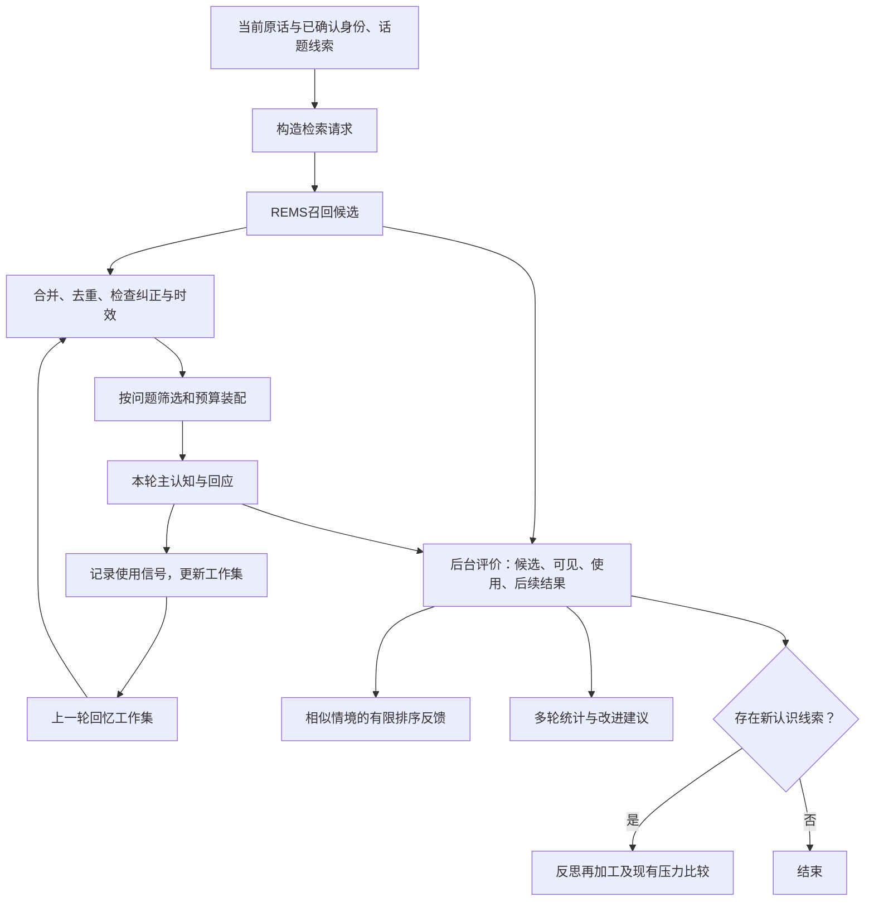

# 回忆筛选、跨轮保留与评价闭环：修改方案

实施状态（2026-10-26 00:02，北京时间）：程序与回归已完成；实际取舍和验证结果见[实施记录](回忆闭环-实施记录.md)。下文保留原方案，原文的“本轮只写方案／尚未实施”描述属于方案编写时点。

状态：方案中，尚未实施。日期：2026-10-25（北京时间）。

范围：基于当前 JShi 工作区代码核对，设计召回、筛选、跨轮工作集、评价、自我改进与反思的协作方式。本次只写方案，不修改运行程序、提示词正文或记忆数据库。已有未提交改动作为本次阅读基线，不覆盖。

## 1. 建议与目标

建议采用“适度扩大候选池 → 有预算的证据筛选 → 当前主认知使用 → 相关内容跨轮保留 → 后台评价 → 分别用于检索改进与必要的反思”。

重点不是让主认知读更多，而是增加找到正确材料的机会，同时减少重复、过时、错误归属和已被纠正的内容占据上下文。不要每句话固定新增一次同步大模型调用。先修正材料、预算与追踪链路，再用对照实验决定是否需要独立模型筛选。

本轮有三个独立目标：

1. 找得全：在可控成本内增加有用证据进入候选池的机会。
2. 用得准：主认知实际收到的材料相关、有来源、保留纠正与不确定性。
3. 接得住：同一话题下一轮复用有用材料；背景变化时及时退出或修正。

评价回答“这次找得和用得怎样”；自我改进回答“许多次下来应该调整什么”；反思回答“这些经历是否支持新的认识”。三者共享证据，但不互相替代。

## 2. 现有代码核对

以下是当前源码可确认的行为，不代表所有能力都已在线有效运行。链接以本文所在目录为基准。

| 环节 | 当前实现与依据 | 缺口与建议 |
|---|---|---|
| 召回入口 | [MemorySource._load](../../src/jshi/assembly/sources.py)使用 `ctx.input_text`，将说话人及提及人物传给记忆接口；`recall_enabled`控制是否调用 | 将检索文本与主认知输入分开；不能把 JEV 说明当作用户问题。人物不确定时明确范围，不把未知人物容器当成一个确定的人 |
| 后端适配 | [Rems3MemoryBackend.recall 所在文件](../../src/jshi/memory/rems3.py)透传 level、limit、人物和锚点，转换回片段；对接近相关度结果做对话人前移 | 尊重现有后端检索，不在外层重做一套向量搜索；补齐候选批次与来源信息。本文不宣称已全面审计外部 REMS 排序算法 |
| 扩大候选 | [MemoryShell.recall](../../src/jshi/memory/shell.py)只有存在反馈且明确指定正数 limit 时才按倍数扩候选，再截回 limit；正反馈作为锚点 | 已有局部能力，不应另建重复壳；应区分候选上限、选中上限和模型材料预算，并避免叠乘扩容 |
| 反馈重排 | 同一文件以候选排名为基线加有限反馈；[adjustments](../../src/jshi/reflection/memory_store.py)按主体、人物、问题相似度和时间衰减选择反馈，重复取平均 | 保留有界、情境化机制；补话题/人物范围与评价证据，不能把某次无关当成全局无用 |
| 片段转换 | [MemorySource._absorb](../../src/jshi/assembly/sources.py)以 event_id 去重，传正文、时间、人物、来源，importance 固定0.5 | 后端分数、摘要层级等未完整进入装配片段；增加必要程序元数据，不能仅靠固定 importance 解释筛选质量 |
| 预算组装 | [CurrentStateAssembler.assemble](../../src/jshi/assembly/assembler.py)按组和到达顺序装入；非保护片段预算默认1500字符，包含回忆与普通个人世界条目 | 没有完成针对当前问题的证据筛选。先判断预算剩余>0再整条加入，最后一条可超过预算；应按完整可用片段检查能否装入 |
| 旧回忆保护 | `ActivityWindowSource`把旧 recall_excerpts 标为 activity；组装器把整个 activity 来源列为保护来源 | 即使摘录 `always=False`，仍受来源保护而绕过普通回忆预算。应按用途保护现场正文，旧回忆仍受统一预算约束 |
| 跨轮接口 | [ContextViewState 与 apply_context_assessment](../../src/jshi/experienceledger/inprocess.py)支持摘录、删除与聚焦 | 当前源码搜索未见主流程调用该接口形成完整选中回忆写回闭环。接口存在不能等同于功能已接通；实施时逐轮验收实际读写 |
| 主认知反馈 | [SubjectProcess._cognize](../../src/jshi/subject/process.py)保存非空 memory_ratings；同轮 recall_requests 不执行 | 保留现有“一次主认知”节奏；反馈字段须由所有人格共同适配，不让重评分拖慢回应 |
| 后台观察 | [ReflectionMemoryStore.observe](../../src/jshi/reflection/memory_store.py)保存候选快照，有数量/单条长度上限；无 query 或无 fragments 时返回 | 零结果无法进入这条后台评价观察链；需要记录零结果、失败、关闭等不同状态 |
| 回应关联 | `link_outcome`按主体、开始时间以后、evaluate阶段匹配观察；process传模型可见memory来源ID与回应计划 | 时间窗口关联不如精确批次关联可靠；保留候选→可见→使用→交付的完整链。自省认识与旧摘录也要纳入可见清单 |
| 回忆评价 | [RecallEvaluationThought](../../src/jshi/reflection/thoughts.py)已有相关/装入/使用/实际帮助区分；后台 evaluate 保存评价 | 优先复用；补覆盖缺口、证据边界，不能对未看见候选评分 |
| 再加工 | 同文件 `RecallReprocessingThought`形成带来源的新认识，禁止把推测写成旧事实；执行器评价后进入再加工阶段 | 不必每次评价后必跑再加工；按纠正、冲突或关联新证据触发，没有增量直接结束 |
| 自我改进 | [effectiveness/inprocess.py](../../src/jshi/effectiveness/inprocess.py)汇总 memory_ratings；[memory_analyzer.py](../../src/jshi/effectiveness/memory_analyzer.py)有缺少基准时的启发式档位建议 | 与后台反馈是两套记录。统一评价证据后由不同消费者使用。当前代码明确只生成建议，不直接写 recall_strategy，不应描述成自动调优已完整运行 |
| 共同执行器 | [ReflectionExecutor](../../src/jshi/reflection/executor.py)支持登记处理器、持久任务、闲时执行与对话让路 | 继续复用；不为本方案再开独立后台系统。已发出的模型请求不能立刻取消，仍需资源并发限制 |

另一个细节：后台 `materials`按候选顺序装入预算，遇到过长项会停止后续选择。扩大候选后必须标记评审实际覆盖范围，并允许跳过无法装入的长项，避免把“只看了前几条”写成“评价整个候选池”。

## 3. 总体分工与时序

JEV1_1继续负责入口；JEV1_2仍只决定是否需要回忆，不承接回忆评分；JEV2继续维护现场、人物与话题，不变成长期记忆筛选器。工作集可以引用现场话题，但不依赖JEV2每次及时完成，也不把话题摘要当成不可修正事实。

跨轮复用不是“下轮才给本轮需要的材料”：本轮必需证据在主认知前提供；后台发现的补充仅影响后续输入，不能直接修改已经完成的答复。若后续证据表明已答内容有误，形成明确纠正事项，是否主动回应由既有交往流程判断。

## 4. 检索请求：先改善材料，再扩大数量

建议新增程序内部 `RecallRequestContext`，与发给主认知的 input_text 分开。至少包含：主体、活动/会话、当前用户原话、可追溯的当前话题线索、人物范围及确定程度、时间约束、明确锚点、检索目的、预算和版本。

- 原话从结构化输入取，不靠对最终长字符串随意删句；保留否定、纠正、时间和被引用人物。
- “这个人”“刚才那个约定”等可附与指代直接有关的少量现场材料，并标来源；不拼整份片场、JEV判断或完整回复历史。
- 身份确定不等于所有记忆都只关于当前说话人。关系问题需要覆盖参与人物；未知说话人可按已知话题或明确提及对象召回，不能借未知桶推断人物身份。
- JEV关闭召回、真实检索零结果、后端失败、预算跳过分别留痕，避免混成同一“没有记忆”。
- 默认一次检索；明确多对象/多主题问题可采用有上限的子查询，记录各自目的及去重结果，不无限扩展。

候选规模与展示规模分开。初次实验可以比较当前候选上限K与2K，在后端契约允许的范围内另测4K；这些只是实验组，不是推荐最终默认值。必须设置总候选数量、正文大小、检索耗时上限，避免后端条目展开后失控。现有反馈扩候选不能再次把2K乘4。

## 5. 筛选：选择证据，不只选择相似句子

第一阶段采用可解释的程序筛选，不增加固定模型调用：

1. 校验主体与人物适用范围，区分说话人、被谈论的人、系统自己的陈述。
2. 按事件稳定ID及表示版本去重；同一事件多种摘要保留最适合预算的一种。不要把仅内容相似的不同事件直接合并。
3. 优先携带明确的纠正关系、原始支持片段与必要冲突信息。
4. 在后端相关排序基础上保留问题所需不同证据，避免前几条都是同一事件的重复表达。
5. 选已有完整摘要或来源明确的原文摘录，保留否定和限定条件；不在字段/句子中间硬截断。
6. 合并上一轮仍相关的工作集条目；新旧候选同台筛选，不给旧条目永久优先权。
7. 按总预算装配，并记录每条跳过的原因。

程序不能可靠地理解所有语义矛盾。没有结构化纠正关系时，不能仅凭时间新就把另一条判错；保留冲突和不确定性，由主认知判断。对于复杂长事件的语义提炼，可先用离线或后台模型实验；仅在证明答案质量收益足以抵偿延迟后，再考虑按需同步筛选。

独立模型筛选的启用条件可以是：关系问题存在多条冲突、候选普遍为长混合事件、已有摘要不足以保留关键依据。其超时退回程序选择，不能阻断正常回应。不要把评分、完整反思和内容重写都塞进筛选调用。

## 6. 回忆工作集：保留可继续使用的证据

建议增加一个有明确生命周期的 `RecallWorkingSet`，由记忆编排维护，组装器只读本轮快照。存储可复用现有SQLite基础设施，但不同时维护“旧摘录表”和“新工作集表”两个权威状态。选择新结构作为权威后，旧 recall_excerpts仅作为兼容读入/展示投影。

### 6.1 最小条目结构

| 字段 | 作用 |
|---|---|
| subject/session/topic_scope | 隔离主体、会话与适用话题；话题可暂定，不强制依赖JEV2编号 |
| event_id、source_ids、representation_version | 回到原始事件、识别摘要更新与纠正 |
| excerpt、source_span | 有用内容及原文位置/来源；模型提炼要标明性质 |
| actors、attribution_status | 涉及人物和归属确定性，不用单个object_id替代多人关系 |
| occurred_at、observed_at | 发生时间与此次看到时间分离；未知就是未知 |
| evidence_kind、validity | 当事人陈述/系统回答/工具结果/推测；有效、存在冲突、已纠正或待核实 |
| relevance_reason、last_visible_turn | 当前为何保留、最近何时实际给主认知看过 |
| retain_reason、review_after | 后续保留依据及复查时点，不等同于事实有效期限 |

以上主要留程序侧。模型只看短代号、必要人物/时间、摘录、来源性质及纠正提示，原始长ID和内部状态不全量注入。

### 6.2 状态与更新

- 候选未必进入工作集；选中并实际装配后才记录本轮可见。
- 与未完成问题直接相关、被主认知引用或明确指出后续仍需使用的条目，可跨轮保留。
- 主认知未给保留建议时，程序可短期保留本轮相关选集，下一轮重验相关性，不能默认永久续期。
- 话题转移：退出当前可见集，允许留在有容量上限的会话缓存；回到旧话题时重新验证。退出上下文不删除长期记忆。
- 人物变化：重新验证人物范围；多人共同事件可继续使用，个人推测不能串给另一个人。
- 纠正发生：给旧条目增加关联与状态，更新展示；保留历史可追溯性。
- 后台迟到：携带生成时的会话、话题、输入版本和基础工作集版本；版本冲突时重新合并或丢弃，不能覆盖较新的纠正。
- 重启恢复：持久条目仍需重新检查版本和适用范围，不能直接当作最新事实。

### 6.3 预算

第一版实验保持现有非保护材料预算作为基准，先修正其硬上限与来源绕过问题；然后独立比较更大预算是否值得。人物认识、事件、旧摘录和普通个人材料的分配应可观察，不能只记录一个总字数。

修复 activity 保护时，只保护真正必要的现场正文。若旧回忆已重复嵌入现场正文与摘录字段，应从渲染源头去重，不能只给摘录扣预算、正文仍免费重复。

## 7. 统一评价记录：一次事实、多种使用

不新增第三个评分系统。扩展现有观察与反馈结构为统一记录，由主认知使用信号、后台评价和质量统计分别补充。旧 memory_ratings JSONL可以保留为兼容导出，后台 feedback可以保留为查询投影；不能双方独立产生互不关联的权威分数。

### 7.1 追踪链

每次召回建立 `recall_run_id`，明确关联 activity_id；多个子查询有各自query_id。记录：

`请求 → 后端返回候选 → 去重候选 → 选中 → 模型实际可见 → 模型声明使用 → 回应实际交付 → 后续证据 → 评价`

不再只通过“活动开始时间之后的所有观察”关联。一个活动多次召回、多个活动交错、主认知失败、后台重试均依靠ID及版本正确归属。兼容旧记录时标记 legacy_unlinked，无法确定就不补造关联。

区分五个问题：

| 问题 | 证据来源 |
|---|---|
| 找回来了吗 | 后端实际返回集合 |
| 给主认知看了吗 | 最终请求组包快照，而非中间选择结果 |
| 用在回答里了吗 | 主认知引用/使用信号，必要时后台核对；仍属可错判断 |
| 回答真的发出了吗 | 现有文字/语音交付状态，计划不等于交付 |
| 真正有帮助吗 | 后续交流、明确纠正、任务结果；没有证据标未知 |

### 7.2 评价内容

逐条记录相关性、人物适配、重复、误导、来源可靠性问题、可见与使用状态；整次记录覆盖充分/不足/无法判断、可能缺什么、失败阶段及理由。保留评价者/模型/提示词版本和所见材料范围。

零结果也记录，但不自动判失败：影视对白可能根本不需要记忆；明确询问旧约定却没有材料，才应标有缺口的可能。找不到某条记忆时，不能编造不存在的event_id。

模型自评是待验证信号，不是真实标签。未给评分≠无用；未被引用≠无关；用户没反对≠正确。用户明确纠正通常比系统自信复述更有力，但仍应核对纠正的是哪个命题、哪个时间范围。

## 8. 自我改进与反思的边界

| 环节 | 输入 | 输出 | 是否影响本轮回应 |
|---|---|---|---|
| 程序筛选 | 当前问题、候选、工作集、预算 | 当前证据集与选择理由 | 是，不固定增加模型调用 |
| 主认知轻量反馈 | 实际可见材料与作答 | 使用/冲突/缺口/后续保留信号 | 随现有调用输出，不要求长理由 |
| 后台回忆评价 | 精确召回链与后续证据 | 本次情境化评价 | 否 |
| 质量改进 | 多次统一评价、基准集、耗时 | 策略建议及对照实验结果 | 否 |
| 反思再加工 | 有新证据的旧经历与纠正 | 可修订的新认识与来源 | 否 |
| 压力比较 | 现有新认识候选与样本 | 相对保留标准、入库建议 | 否 |

当前 evaluate→reprocess→compare自动衔接改为条件衔接。评价发现“只是不相关”可结束；发现真正关系增量或纠正再进入再加工。压力比较继续服务于新认识，不拿它代替实时检索排序。

只做一条反馈应用链：评价产生情境化证据，质量改进提出全局策略；策略应用明确版本和控制方。保留现有有限反馈，不允许两套模块各自乘一次扩容或同时调整相反参数。

## 9. 修改清单与实施顺序

### 阶段A：追踪与预算基线

涉及 `assembly/port.py`、`assembly/sources.py`、`assembly/assembler.py`、`memory/port.py`、`memory/shell.py`、`reflection/memory_store.py`、`subject/process.py`。

- 分离检索query与认知input；建立精确run/activity/query关联。
- 记录零结果、关闭、失败、预算裁剪及最终模型可见集合。
- 修复整条超预算、activity摘录绕过、跨来源重复。
- 暂不扩大默认候选量、不调整主认知模型、不增加同步模型调用。

完成标准：同一条记忆从返回到交付可追踪；没有结果也能知道原因；预算没有未说明的溢出。先跑离线回放，避免修正预算时悄悄裁掉关键关系证据。

### 阶段B：候选筛选与跨轮工作集

建议新增 `memory/selection.py` 与 `memory/working_set.py`，分别负责纯选择策略与有版本的生命周期；由现有MemorySource/主流程接入，不再增加对外服务。

- 扩展候选和展示预算的独立配置；只在一个位置实施候选扩容。
- 合并已有摘要、纠正、人物与旧工作集；每次给出选取/跳过理由。
- 接通持久化与下一轮读取、输入修订和后台迟到保护。
- 梳理experienceledger旧摘录兼容通道；避免另一个写场再次无来源地永久复述所选材料。
- 主认知保留轻量反馈统一契约，各人格分别检查解析；具体字段增改必须实测新增输出成本。

完成标准：同话题能复用、换话题会退出、纠正能替代、重启不混人；新工作集不额外写成长期事件。

### 阶段C：评价与自我改进归一

涉及 `reflection/thoughts.py`、`reflection/executor.py`、`reflection/memory_store.py`、`effectiveness/ratings.py`、`effectiveness/inprocess.py`、`effectiveness/examples.py`及相关统计。

- 回忆评价只补充统一记录；精确指明评审看过哪些材料。
- 后续交流按活动/话题与时间窗关联，不能把之后所有对白都算成本次结果。
- 以有证据的条件触发再加工；保留共同执行器与对话优先。
- 旧评分与新记录映射有版本；缺失值保留未知，不能填0混入基准。
- 改进建议暂不自动修改默认配置；有对照证据后再逐项启用。

完成标准：一次召回不会重复计样本；零结果可评价；主观反馈不能无限强化自身；再加工无新内容不产生新记忆。

### 阶段D：按需模型筛选实验

仅在前述改动仍有明确短板时进行。比较“程序筛选”和“程序筛选＋条件模型筛选”，固定候选与预算，测完整耗时和最终答案。未证明收益前不开为默认。

## 10. 提示词及文档同步范围

本方案不修改任何当前提示词全文。实施时按照项目规则同步程序真实system/user、Schema、完整请求文档和README北京时间更新时间。

- P20-10.0、P20-20.0：明确回忆证据、来源与纠正、轻量使用反馈；不要要求每轮长篇评分。
- P80-30.0回忆评价：复用原职责，补零结果、可见/使用/交付/帮助分离、整次覆盖评价。
- 回忆再加工及压力比较对应当前索引条目：修改触发说明与输入范围，不重新发明编号或批量生成正文。
- 写场相关提示词：核对是否把临时回忆转成无来源现场事实，保留修正与出处。
- JEV相关：原则上不增加提示词职责；只有输入/字段契约确实改变时才同步。
- `doc/回忆自省与动态标准.md`：实现后更新共享记录、条件再加工、反馈应用路径。

程序侧追踪用完整ID；发模型前映射短代号，同请求映射一致；跨请求通过程序恢复引用，不假定M1下一轮仍是同一事件。保留绝对时间/相对时间/持续时长区别及来源时效。

## 11. 验证设计：如何知道真的变好

### 11.1 基准材料

从真实历史选择别名确认、关系纠正、旧约定、时间变化、多人指代、同话题接续、换话题再返回、旁聊/影视无须回忆等类型。近期已观察到的“qf/小秦/勤奋”和关系误判可作为候选案例，但必须回到原始来源人工核定；本方案没有把系统旧答复当作正确答案。

每例标明提问时刻、允许看到的历史、必要证据ID、错误/已纠正证据、可接受答案或应当承认未知。不让未来纠正泄漏到较早测试时刻。开发样例与留出验证样例分开，新增反馈不能污染对照组。

### 11.2 对照组

1. 当前实现，冻结数据与配置。
2. 只修query/追踪/预算，候选规模保持。
3. 增加候选和程序筛选，展示预算不变。
4. 增加跨轮工作集，回放完整会话。
5. 有限后台反馈；单独检验是否强化旧错误。
6. 可选模型筛选，仅在有针对性的困难样例中测试。

一次只改变可解释的因素；相同模型/提示词/索引版本，记录缓存、网络和服务器条件。可重复回放以观察模型波动，但不靠挑选最好的一次结果。

### 11.3 指标及解释

| 指标 | 定义/用途 |
|---|---|
| 候选必要证据覆盖率 | 已标注必要证据中实际进入候选池的比例；不是凭模型猜召回率 |
| 可见必要证据覆盖率 | 必要证据最终进入模型输入的比例，定位筛选/预算损失 |
| 上下文有效率 | 人工标注相关材料所占条数与字符比例，分别报告 |
| 纠正遵循率 | 已有有效纠正时，回答是否避免继续采信旧错误 |
| 人物归属正确率 | 身份与关系证据是否应用于正确人物 |
| 答案有据率 | 关键判断能否由实际可见来源支持 |
| 跨轮连续性 | 接续问题必要材料仍可见，换题后无关材料退出 |
| 延迟/成本 | 检索、筛选、组包、主认知、端到端各自p50/p95；输入输出token、调用数、后台资源 |

不把“用了更多记忆”“评价更高”“答得更长”当成质量提升。样本不足时报告逐例结果和不确定性，不给虚假精确提升百分比。

### 11.4 程序测试

复用并扩展 `tests/test_assembly.py`、`test_memory_shell.py`、`test_reflection_memory.py`、`test_effectiveness.py`、`test_effectiveness_baseline.py`、`test_cognition_recall.py`、`test_recall_object_bind.py`。

新增重点：预算边界与完整摘录、同事件跨来源去重、多人范围隔离、零结果观察、精确run关联、多个查询合并、语音修订、迟到结果、会话切换、旧记录兼容、模型非法引用、反馈重复幂等、自省认识不可递归强化、已纠正事实不回流成真。

跨轮测试至少模拟“问关系→纠正→换题→再问关系”；另做话题未结束但中间插入几轮闲聊的回放，避免靠固定最近N轮误删有用材料。

## 12. 延迟、上线与回退

新增同步耗时约为：增量检索＋程序筛选＋工作集读取＋实际增加的模型输入成本。复用若减少检索和冗余输入，可能抵消部分成本，但必须实测。独立模型筛选还增加一次服务调用，不能承诺免费或固定毫秒数。

按阶段使用独立开关：选择策略、工作集、统一评价、反馈应用、可选模型筛选。模式可采用off/shadow/on；影子阶段只记录建议选集，不改变用户实际输入。数据库迁移新增字段/表、带schema版本，保留旧记录；关闭新模式能回到原读取路径，不删除长期记忆。

上线门槛：关键身份与纠正用例不能倒退；候选覆盖增益能转化为可见证据或答案收益；端到端p95符合项目实际约定。延迟预算由基线和用户体验确定，本文不凭空规定可接受增加多少秒。

运行页建议展示：召回开关及原因、候选/选中/可见数量、跨轮复用数量、预算裁剪原因、纠正/冲突数量、后台评价状态。点击某条能看来源和为何保留，避免只显示一个模糊“记忆评分”。

## 13. 研究依据与适用限制

检索增强把外部证据检索和生成结合，是已有研究路线，支持保留检索与生成职责分离；它不能证明本项目某个候选数最优。参考：[Retrieval-Augmented Generation for Knowledge-Intensive NLP Tasks](https://arxiv.org/abs/2005.11401)。

长上下文研究显示，相关材料的位置与干扰材料会影响模型利用信息的表现，支持“扩大候选池不等于扩大主认知全文”的设计方向；研究所用模型和任务并非本项目当前模型，不能直接套用其效果大小或预算。参考：[Lost in the Middle: How Language Models Use Long Contexts](https://aclanthology.org/2024.tacl-1.9/)。

本方案的具体工程选择主要来自上述本地代码缺口与可验证的实验设计。最终建议优先做阶段A、B，再接通C；D保留为待验证选项。先让证据流转正确，再追求召回规模与模型复杂度。
