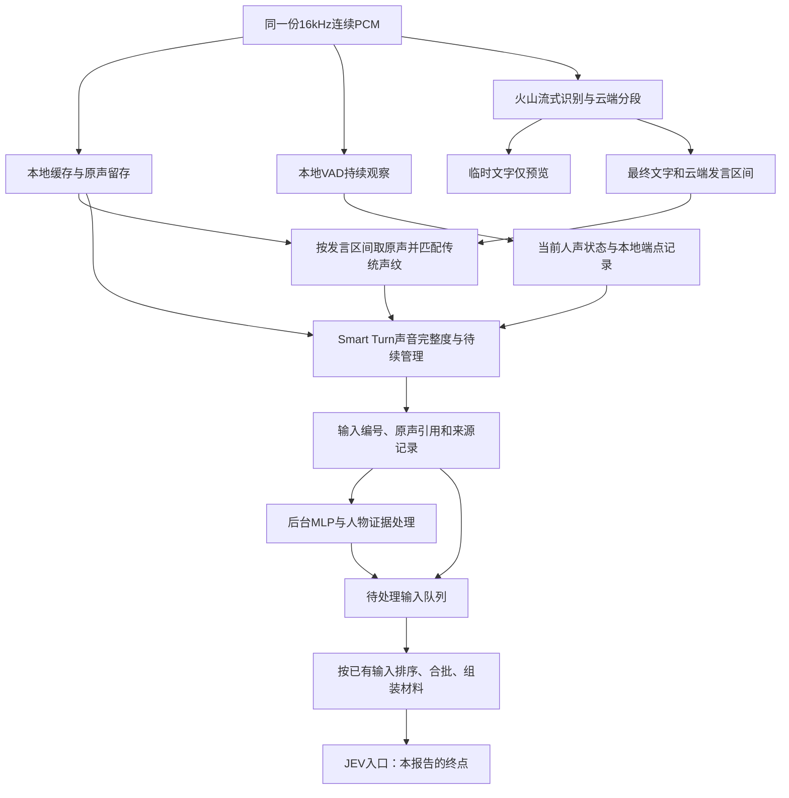

# 送入JEV之前：六场景阶段测试报告

最近更新时间：2026-10-30 09:37（北京时间）。

## 结论

**信封阶段已经具备可重复测试的基础，已验证若干组件修复；尚未达到“断句、人物与合批都稳定”的结论。** 当前最明显的不足是：本地声音判断主要在火山定稿后工作，尚未真正提前协调云端断句；人物证据有波动和冲突，正式会话的完整合批／人物仲裁尚未用这些录音端到端验证。

本报告截止于材料交给JEV，不讨论JEV的main、背景等输出，也不以其结果反推信封质量。本轮仅汇总已有数据与当前代码，没有新增录音外发或修改程序。

## 1．测试范围和证据强度

六份不同录音合计162.5秒，所选在线运行共返回30段最终文字。在这些运行的声学适配器中，30段各有一次释放记录；这是“已产生的最终片段未观察到漏发／重复”的证据，**不是原声没有漏识别、漏句或漏人的证明**。

| 场景 | 原声时长 | 在线最终段数 | MLP情况 | 版本及范围 |
|---|---:|---:|---|---|
| 数学教学-单人 | 18.2秒 | 3 | 本次选用的基线未运行 | 边界修复＋声学辅助初版 |
| 三人对话-依次说话-独立 | 60.0秒 | 6 | 后来离线补跑6段 | 跨话轮保护修复前的运行 |
| 三人对话-手机 | 30.3秒 | 8 | 同步后台记录8段 | 跨话轮保护修复前的运行 |
| 数学教学-lg简单互动 | 22.3秒 | 4 | 同步后台记录4段 | 2026-10-30授权复测，含断轮保护 |
| 数学教学-lg简单互动2 | 10.4秒 | 3 | 同步后台记录3段 | 同上 |
| 数学教学-lg简单互动3 | 21.3秒 | 6 | 同步后台记录6段 | 同上 |

因此不能把六个运行当作同一最终版本的整套回归。另有旧CPU本地识别对照，它不是火山侧本地声学旁路；其6秒窗口结果不参与上述在线段数统计。

已有182项合并自动化回归，涵盖多个模块和接口，不等同于六段真实音频的准确率验证。缺少逐字转写、逐段真实人物、媒体来源和实际播放的人工标注，暂不能给出准确率／召回率。

## 2．当前实际流程

“信封阶段”是双方约定的流程范围，不代表代码里某一个InputEnvelope对象在最前面就一次建好。实际输入记录会逐步补齐。

关键事实：VAD持续接收音频，但它输出的局部端点目前用于状态与诊断；不会据此把火山临时文字直接提交。Smart Turn针对最终转写对应的原声区间工作。MLP在声学释放后的输入处理中运行，**尚未前置参与这次声学续句分组**。

## 3．各子阶段的现状

| 子阶段 | 当前判断 | 已有证据／主要缺口 |
|---|---|---|
| 输入接收与原声保存 | 基础可用 | 六场景原件独立保存、摘要检查、可重放；旧素材没有原始逐包接收索引 |
| 时间关联与取音 | 明确缺陷已修，仍需覆盖更多边界 | 同一PCM时间轴；末尾20ms内有界取音容差已在多段复现验证；跨会话、重连等尚未由这些素材覆盖 |
| 断句与最终文字形成 | 尚未达到目标 | 火山仍决定最终分句与定稿时机，本地辅助是定稿后的完成／续句判断 |
| 传统声纹与MLP | 有用但不稳定 | 能提供熟人证据、短句候选、媒体拒认；有实名波动、验证限制和来源冲突 |
| 完整度与续句释放 | 已接入，部分缺陷已修 | 有明确未完暂存、期限、EOF和断轮保护；声音完成不保证语义完成 |
| 完整信封组装与送入 | 证据不足 | 正式路径有输入ID、人物处理、排序与合批；现有适配器没有完整复现这些模块的联合行为 |

### 3.1 原件和时间：可以复测，但不能精确复刻原现场

- 连续原声保留了原片段内的停顿、背景与重叠声音，可以重测分段，不依赖旧切句结果。
- 火山发送与本地缓存使用同一PCM，正常同会话内可以用音频位置关联。**共同坐标不等于双方切点相同，也不等于结果返回时间相同。**
- 这些素材没有逐包到达索引，只能按采样节奏重建输入；原现场传输抖动／暂停未知。
- 匠石播放内容、已播位置与停止事件没有随场景完整保存。麦克风里即便收到了匠石回声，也不能自动知道其出处；不能把未知播放状态写成“没有播放”。

已修：末段比原声长2ms时，不再整段取音失败；20ms以内只使用已有原声，不补静音，原请求时间与实际取音边界都保留。单人样例和后续互动2／3均有2ms边界实例。真正缺块、越界过大或起点已丢失仍失败。

### 3.2 断句：主要瓶颈仍在“什么时候能拿到最终文字”

手机场景首段：

| 声音开始 | 声音结束 | 声音持续 | 最终包读取 | 声学模块释放 |
|---:|---:|---:|---:|---:|
| 4.452秒 | 16.732秒 | **12.280秒** | 27.202秒 | 27.479秒 |

约10.470秒发生在最终文字可用之前，不能归到Smart Turn计算或旧本地6秒窗口。此前已有临时文字，本地VAD也在输入约13.300秒时输出过一个局部声音区间，但没有形成可提交的云端最终输入。

后续互动样例也有波动：互动3第二段2.922–5.722秒、持续2.800秒，最终结果约晚3.917秒才读取。另有约0.7–1.4秒的实例；不能把一次快或慢当整条链路固定延迟。

**结论：当前“加了声学辅助”不等于已经解决云端晚定稿。** 火山内部为何晚定稿尚未完全查明；本地目前也没有完整的“局部端点＋稳定临时文字＋修订撤回”会合机制。

### 3.3 人物：必须同时保留传统声纹和MLP，不能合成一个确定分数

| 实例 | 传统声纹 | MLP | 能说明什么 |
|---|---|---|---|
| 依次说话中2.151秒／2.209秒片段 | qf最高0.328／0.329，未过0.33门槛 | qf约1.000，但仅参考 | 仅报“待定”会漏掉候选支持；仍不能直接确认姓名 |
| 手机场景0.960秒“一个是喝的” | 样本不足 | luguang约0.997，仅参考 | MLP对短句有补充价值，但本时长／模型未允许正式确认 |
| 依次说话中2.029秒片段 | 姓名未确认 | qf约1.000、lux约0.971 | 多个独立分类器同时高分，不能只取最高分 |
| 互动3的6.002–8.232秒、持续2.230秒 | 确认luguang，约0.372 | qf约0.998，仅参考 | 两类证据冲突；没有真值不能宣布某一方正确 |
| 手机场景12.280秒疑似电视讲解 | 未确认熟人 | 最高luguang约0.468 | 本例没有直接认成熟人；不代表电视误认已全面解决 |

当前正式规则区分参考高分、已验证模型、适用时长档位及正式确认；qf等高分不等于100%身份概率。本报告也不按场景标题给模型指定正确姓名。

### 3.4 完整度与续句：有作用，但“说完”的标准还不够完整

已有真实表现：单人样例后两段被判未完，保留到EOF释放；依次说话样例中一段等待约2秒后放行。完成／未知或预算耗尽可放行，未知不伪装为完成。

两个主要问题：

1. **人物证据波动会断开声学续接。** 依次说话中同一云端轨迹相邻段从“qf”变“待定”，原先并未联合判断，而是前段等到期限。这与MLP后来仍支持qf同时存在；MLP没有参与前置分组，所以补测高分不会自动修复过去的释放。
2. **同人不等于同一话轮。** 手机样例lux两句话之间出现别人“一个是喝的”，旧版仍把两段lux联合。现已增加中间不同声音／另一轨迹未知应答的断轮屏障，A→B→A本地回归通过。原手机运行保留为修复前证据；没有把它重标成修复后的真实运行。

Smart Turn判断的是声音完成倾向，不保证含义结束；短句、问句、应答、背景媒体需要进一步评价。当前未知／重叠／缺音频会按规则直交或降级，不是所有30段都必定进行了完整度推理。

### 3.5 最终组包：不能拿独立探针代替正式全链路

正式程序在声学释放后创建输入记录和ID，后台启动MLP，结合人物证据；正常输入可有限等待MLP，控制场景优先不等。输入队列只收集已经就绪的材料并排序，之后由入口调度组装送给JEV。

独立测试则记录声学释放，后台观察MLP，再以固定片段做后续调用。它没有完整重现正式人物仲裁、队列背压、源分离、修订替换、短编号映射、正常合批与控制旁路的组合效果。

所以当前可以说：**已看到最终片段在适配器中各释放一次；不能说正式JEV收到的每批信封已经全面验证正确。**

## 4．哪些已修，哪些还没解决

| 项目 | 状态 |
|---|---|
| 模型加载时间挤压回放节奏 | 已修并增加回归；受影响旧运行不作时延证据 |
| 末尾小幅越界导致声纹取音整段失败 | 已修，有原声复验及后续样例证据 |
| A→B→A仍跨话轮联合 | 已修保护条件，有本地最小复现与回归；不能外推所有真实换人情形已覆盖 |
| 仅有释放时刻、不知道本地VAD何时切过 | 已增加窗口与输入位置记录 |
| 火山晚定稿 | 已定位等待区段，内部成因和端到端改善未完成 |
| 用本地声学更早形成可处理输入 | 当前仍以最终文字为前提，未完成前置会合 |
| 声纹／MLP冲突及临时分组 | 已保留证据，尚未完成真值评价和统一校准 |
| 正式人物仲裁＋合批＋送JEV端到端 | 未由本批场景完整覆盖 |
| 匠石实际播放上下文随录音收录 | 当前这批素材缺失；尚不能验证回声与播放中打断的真实现场 |

## 5．下一步建议，只聚焦JEV之前

1. **先补完整入口观察点。** 使用同一录音走正式在线会话，在“即将调用JEV”的位置捕获真实batch、原声引用、人物证据、原始时刻和本批范围。终点用记录接收器，不运行JEV。这样能核对真实组包，而不是继续扩大独立探针结论。
2. **补少量人工真值。** 先标这六段中说话人、电视／真人／匠石回声、合理停顿和必要续句；保留不确定区间。优先标短应答和冲突段，不必一次逐字标完所有录音。
3. **再做端点会合对照。** 比较云端临时／最终文字、本地VAD、声音完整度和修订，明确提前输入何时可撤回、何时只作预览。没有修订与范围协议之前，不直接把临时文字当最终输入。
4. **验证声学连续性与实名分离。** 姓名暂不确定不应必然丢掉声音连续性；同时不能只凭云端同轨或MLP高分跨人拼接。以已标注的A→B→A、短应答、电视干扰检验。
5. **同步收录匠石实际播放事件。** 保留播放文本、开始／结束／打断、实际播出位置和可用音频，独立于麦克风原声，并有共同时间线。

建议首先做第1项。它直接补上目前最重要的验证缺口，也能使后续“断句更准／更快”的结论落在真正送入JEV的输入上。

## 证据入口

- [六场景逐段结构化汇总](C:/Users/Lenovo/Desktop/project/JShi/test_runs/pre-jev-20261030/summary.json)：不包含JEV输出，每段起止、持续时长、释放次数及MLP覆盖范围。
- [三个剩余场景的在线报告](C:/Users/Lenovo/Desktop/project/JShi/test_runs/rounds/authorized-20261030/汇总报告.md)：读取其中原声、人物和时序部分。
- [手机场景报告](C:/Users/Lenovo/Desktop/project/JShi/test_runs/entry/online-2f379519b46f4f9eb7f704cc4f344e79/测试报告.md)。
- [手机场景原因与本地复现](C:/Users/Lenovo/Desktop/project/JShi/test_runs/entry/online-2f379519b46f4f9eb7f704cc4f344e79/原因分析.md)。
- 当前程序：`app/voice.py`、`voice/online_turn.py`、`turns.py`、`audio_buffer.py`、`personal.py`。代码检查与真实样本观察在上文分别说明。
