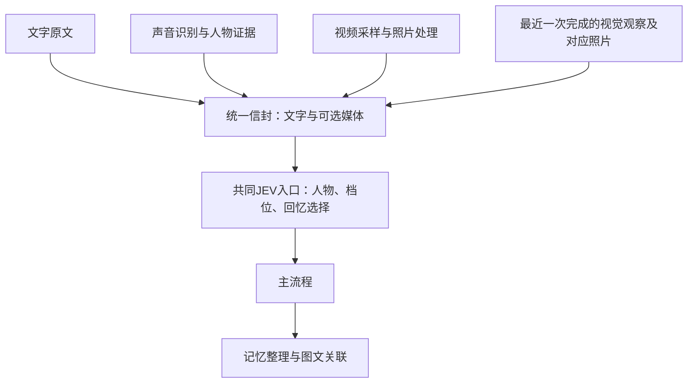

# 视觉输入与环境观察

最近更新于 2026-11-25 07:25（北京时间）。

## 启动

在项目目录安装视觉依赖：

```powershell
python -m pip install -e ".[vision-yolo]"
```

在本机 `.env` 中选择变化检测器。模型与声音面板中的「视觉理解」可以单独选择本机千问或云端服务。

```dotenv
JSHI_VISION_REFRESH_STRATEGY=auto
JSHI_VISION_LOCAL_REFRESH_SECONDS=2
JSHI_VISION_DETECTOR=yolo
JSHI_VISION_WEIGHTS=yolo11n.pt
```

默认视觉服务位于 `http://127.0.0.1:18765/v1`，模型为 `mlx-community/Qwen3.6-35B-A3B-4bit`。启动方式见[模型设置与路由](模型设置与路由.md)。本机路由无需密钥。选回云端时可在模型面板配置该服务，或显式设置 `JSHI_VISION_ENDPOINT`、`JSHI_VISION_MODEL` 和密钥。YOLO 权重可用现有本机文件。

使用匠石实例的主体ID启动，不是发言人物的ID。当前项目的匠石主体是 `stone`，可在数据目录的 `identities.json` 查看主体列表：

```powershell
jshi --data-dir .jshi vision stone --asr local --port 8765
```

打开 `http://127.0.0.1:8765/`。顶部「开始对话」和「开始视频」是独立开关；开启后高亮显示「对话中」「观察中」，再次点击关闭。视频开启时会同时确保语音已开启。底部「文字」只展开或收起输入框，不改变语音和视频状态；展开后可选择「图片」或粘贴图片。实时视频固定在上方中央，占可用内容区域约七成；下方聊天记录占约三成，独立滚动。点击画面或「放大」查看大画面；「隐藏画面」收起视频，只保留控制栏，对话区自动扩大，点击「显示画面」恢复。隐藏只改变显示，不停止采样；停止视频后保留最后画面。文字输入仍从底部展开，收起后内容保留。预览连续播放，默认每 2 秒截取一张照片采样，显示实际配置间隔和最近采样时间。后端按所选策略处理采样。图片仍显示在聊天记录中。连续选择的照片横向排列，点击缩略图查看大图。语音服务未就绪时，视觉上传会拒绝执行。再次点击「观察中」停止视频，语音继续；关闭对话时也停止视频。输入消息默认只显示人物与内容，每条可独立展开或隐藏详情，后续身份判断不会重置展开状态。权限由浏览器提示。

视觉启动入口现在复用完整语音服务初始化。默认本地语音识别需要已有本地语音依赖与模型；也可使用 `--asr online` 并配置语音服务凭据。YOLO不替代语音识别模型。

已有语音入口也可以启用 `JSHI_VISION_ENABLED=true`，使用同一聊天页的视觉控件；`/vision` 是独立观察页，不嵌入聊天页。页面关闭或停止采样后，已有环境描述仍保留观察时间，不应当作实时画面。桌面入口绑定本机回环地址。使用 iPhone 麦克风和摄像头时，可开启[手机设备入口](手机设备.md)。

不安装 YOLO 时可安装 `.[vision]`，使用默认 `JSHI_VISION_DETECTOR=change`。这个轻量模式只比较画面变化，无法识别人或物体；场景文字由所选视觉模型生成。

## 实际处理路径

1. 画面通过独立媒介信封接收，保留来源、采集时间、接收时间、原始时钟及校准误差。首次画面交给所选视觉模型描述人员位置、空间布局、主要物体与特殊情况。
2. 本机千问使用后台识别线程。稳定画面的两次识别开始时间至少相隔 `max(2 秒, 上次识别耗时 × 1.5)`，到期取下一张采样。若上次识别用时 3 秒，目标间隔为 4.5 秒；每 2 秒采样时，实际可能在第 6 秒开始。定时观察只更新可读取的结果。日常识别仅发送本张图和观察要求。
3. YOLO 检出变化时，空闲就立即读图。模型忙时只留一个待刷新的位置，之后检测完成的采样覆盖它。模型线程在实际开始时取走该帧，等待线程期间仍可替换。采样端也只暂存一张，同一主体迟到的旧图不能覆盖正在待检的新图。检测框按采样记录，跨镜头身份仍需独立证据。云端沿用检测变化与冷却策略，本机也可用 `JSHI_VISION_REFRESH_STRATEGY=change` 选择原策略。
4. 四种来源先统一封装为“文字＋可选媒体＋来源、时间及人物证据”，再进入同一个既有JEV入口，沿用人物终审、主认知档位和回忆选择规则。不再有独立的环境JEV及其 `enter_main` 判断。原有后台JEV片场整理仍保留职责。
5. 语音和文字输入只读最近一次完成的观察，照片、描述、拍摄时间和检测证据来自同一帧。首张尚在识别时，本轮直接用已有输入继续。后台完成的新观察供随后进入的输入使用。
6. 每轮主流程关联所用环境版本与原素材。进入现有记忆整理时，环境文字与照片引用随来源关联保存；相同描述避免重复追加，不增加每轮都要选择“保存环境”的提示词步骤。后台采样本身不逐帧写入语义记忆。
7. 召回经历时返回可用照片引用。已有动作中的“查看”“观察”和“回看照片 <照片ID>：问题”可以重新解读照片；历史结果标注为历史材料，不能覆盖当前环境。转头、转向、移动镜头等物理动作当前跳过，保留后续执行入口。

视觉媒体关联使用持久化旁表，兼容现有本地与 REMS 记忆接口。文字事件与照片可按来源及外部事件 ID 对应，不要求改造外部记忆服务。现有片场仍承担人物与交互背景；环境信息从独立上下文接入。

## 统一入口与可选图片



默认JEV收到文字、环境材料及图片引用。若JEV配置的模型支持图片，可启用 `JSHI_VISION_JEV_IMAGES=true`，通过同一模型请求发送真实图像内容块。使用文字模型时保持false：图片可选为空，引用仍供照片保存与后续取回；不能声称JEV仅凭引用已经看过图片。这项设置只控制JEV实际图片输入，独立的视觉理解始终使用图片。

## 留图、容量与成本

默认值均可通过 `.env.example` 中的 `JSHI_VISION_*` 配置调整：

| 项目 | 默认值 |
| --- | --- |
| 页面采样 | 2 秒 |
| 普通照片存档间隔 | 10 秒 |
| 本机稳定画面刷新 | 基础间隔 2 秒，至少为上次读图耗时的 1.5 倍 |
| 变化检测策略的同来源调用冷却 | 15 秒 |
| 变化检测策略的刷新检查 | 300 秒，在有需要保存的新采样时检查 |
| 每主体云端调用上限 | 每小时 120 次，含失败请求。本机专用路由以单次推理和自适应间隔限流 |
| 普通照片预算及期限 | 256 MiB、24 小时 |
| 经历照片保留预算 | 512 MiB |
| 单张上传上限 | 8 MiB |

照片自动纠正方向、压缩为最长边不超过 1600 像素的 JPEG，质量 82；相同压缩内容去重。普通照片按期限和预算滚动清理；当前环境、正在处理的照片和预算内的经历引用受到保护。照片预算指压缩媒体内容，数据库记录与索引还有额外开销。

经历照片预算满时，继续保存文字关联并记录提示；不能保留的照片以后可能清理。页面明确显示照片不可用，不用失效引用冒充仍有图片。文字环境记忆可以继续召回。线上模型处理过的普通照片不会因此自动永久保存。

浏览器与服务端用往返请求估算时钟偏移及误差，适合当前本机入口；这不是精密多设备时钟同步。所有采样、描述和记忆关联保留时间信息，供后续跨媒介整理使用。

## 验证与边界

- 已覆盖：异步采样、迟到结果、新变化保留、切换来源、JEV 判断、正常主流程环境上下文、语音工作队列、记忆关联与召回、图片清理、主体隔离、调用预算和历史照片重新理解。
- 已用真实 YOLO 权重在公开测试样本上执行 CPU 检测与跟踪，得到人、车辆及跟踪编号；浏览器页面已检查显示与控制台错误。
- 2026-11-24 在本机运行 YOLO11n 和千问。测试图中红色矩形与蓝色圆形的相对位置识别正确。YOLO 在公交车进入的首个采样发出变化信号，下一采样建立跟踪。公交车图正在由千问识别时，语音信封用 0.4 毫秒取回前一张测试图及描述，随后一轮读到了公交车场景。模型实测请求见[本地视觉验证](../work/vision-local-20261124.json)。
- 2026-11-25 在 M5 Max 上用三张样图分别做了三次完整观察。几何图、公交街景、双人照片的中位耗时为 1.06、2.04、1.91 秒。连续送入 A、B、C、D，模型实际读取 A、D。两张照片串行读完用时 3.98–4.06 秒，双请求并发用时 2.86–3.05 秒。各次输出长度、缓存条件与计时范围见[读图耗时与排队验证](../work/vision-refresh-latency-20261125.json)。
- 本轮视觉实测使用隔离数据、测试图和本地服务。真实摄像头持续运行的耗时与功耗尚待现场测量。
- 第一版不会识别人脸身份、理解任意物理动作或精确重建三维空间。人物与主要物体的位置优先描述；YOLO 的检测框只能提供图像中的粗略位置。
